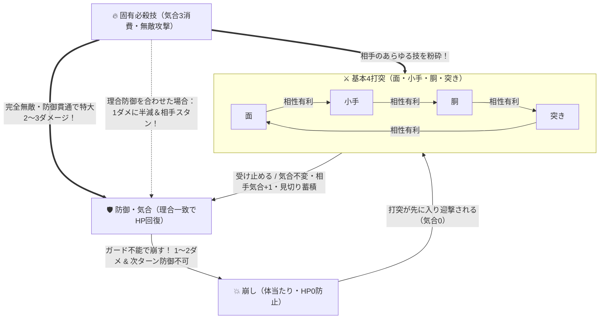

# ⚔️ 剣道 (Kendo) - 高校剣道 激闘の軌跡

[](https://rinevo.github.io/Kendo/)
[](https://github.com/rinevo/Kendo)
[](https://rinevo.com)
[](https://developer.mozilla.org/ja/docs/Web/JavaScript)

ブラウザで手軽に遊べる、**読み合いと間合いの駆け引き**を極限まで追求した本格剣道シミュレーション＆対戦ゲームです。  
基本4打突（面・小手・胴・突き）の四すくみ理合に、三段の構え（中段・上段・下段）と理合一致防御、固有必殺技の覚醒・崩し・応じ技・見切りスタック、そして高度な適応型AIの思考を読む心理戦を楽しめます。

さらに、廃部となった名門剣道部を再建して全国制覇を目指す**「全国制覇モード」**、道場の最高位を懸けて挑むストーリー連戦**「五人掛けの試練（免許皆伝）」**の両モードに**専用オープニングアニメーションムービー**を完全搭載。SVGプロシージャル生成による**「生徒手帳＆顔写真システム」**や心揺さぶる**BGM音響＆リアルタイム音声合成**も備えています。

👉 **[GitHub Pages で今すぐプレイする (https://rinevo.github.io/Kendo/)](https://rinevo.github.io/Kendo/)**


---

## 📚 詳細ドキュメント目次 (Docs)

機能ごとの詳細なゲーム仕様、イベント一覧、パラメータ設計、および技術アーキテクチャについては、以下の各ドキュメントをご覧ください。

| ドキュメント | 主な内容 | リンク |
| :--- | :--- | :---: |
| 🥋 **全国制覇モード** | 廃部からの再興ストーリー・OPアニメ、4大大会（IH・選抜）、大会敵選手の強弱変化（学校ランク＆6種の戦闘アーキタイプ凹凸）、部員のパラメータ別隠し成長率（50%〜150%）、世代交代・引退・エンディング選択、高校生部活ライフイベント全20種、固有得意技覚醒システム、保留バナーUX、オーダー編成・助っ人ダイレクト勧誘、生徒手帳・SVG顔写真連携、8軸レーダーチャート、ミニキャラ連動、防具カラー | [**詳細を見る ➔**](docs/club-mode.md) |
| ⚔️ **一本勝負バトルシステム** | 基本4打突（面・小手・胴・突き）四すくみ相性、三段の構え（中段＝面突き防でHP回復 / 下段＝小手胴防でHP回復 / 上段＝面2ダメ）、理合一致防御＆奥義受け止め、固有必殺技（気合3・完全無敵）、気合闘気システム、気力差による心眼（敵行動予兆の看破と幻惑）、見切りLv蓄積、適応型AI（秘技警戒・見切り警戒）、厳格な剣道作法・音声合成、試練OPアニメ・免許皆伝演出 | [**詳細を見る ➔**](docs/battle-system.md) |
| 🛠️ **技術仕様・アーキテクチャ** | ゼロディペンデンシー設計、FaceGenerator（SVGプロシージャル顔写真生成エンジン）、HTML5 Video 両モードOPアニメーション制御、Single Audio Player BGM制御、Web Audio APIプロシージャル音声・効果音合成、Canvas 60fps描画＆IK・布物理、Glassmorphism＆モバイル最適化 | [**詳細を見る ➔**](docs/technical-spec.md) |

---

## ✨ ゲームのハイライト

### 🏯 2つのゲームモード ＆ 専用オープニングアニメーション

1. **🥋 全国制覇モード（廃部からの再起・高校剣道部シミュレーション）**
   - かつて全国に名を轟かせたものの廃部となっていた名門剣道部。プレイヤーは**1年生創設主将**として埃をかぶった道場を再建し、ゼロから全国制覇を目指します。
   - **🎬 創部オープニングアニメーション**: 始動時に美麗なオープニングムービー（`prologue_revival_anime.mp4`）とストーリーイラストが流れ、ドラマティックに部活ライフが開幕（音声切替・スキップ対応）。
   - 1ヶ月4週のカレンダー制で部員たちに稽古をつけ、夏のインターハイ（個人戦）や春の全国選抜（団体戦）に出陣！
   - 部員ごとに7つの能力値それぞれに50%〜150%の素質を持つ**「パラメータ別隠し成長率システム」**を搭載。同じ練習でも伸びる能力が異なり、部員の個性を形成。
   - 大会で立ちはだかるライバル校・敵選手には**「強弱変化とアーキタイプ設計」**を導入。学校ランク（名門校・中堅校・新興校）による総合力格差や、6つの戦闘アーキタイプ（剛腕パワー型・韋駄天スピード型・不動心気魄型・電光石火/突き技巧型・後の先カウンター型・万能バランス型）による尖ったパラメータ凹凸を再現。
   - 部員不足時は他部（陸上・柔道・野球・吹奏楽・卓球・将棋）から**助っ人をダイレクト勧誘**可能。
   - 日々の鍛錬で眠っていた秘技が開眼する**「固有得意技（必殺技）覚醒システム」**。
   - **🌸 保留バナー進行システム**: 大会直後の新年度進級や部活イベントは無理に割り込まず、道場画面の保留バナーからプレイヤーのタイミングでいつでも開始可能。
   - 新歓・引退・新体制発足の世代交代セレモニーや、**全20種の高校生部活ライフ専用イラストイベント**を収録。3年生引退時には「次世代への継承」または「集大成の部活エンディング」を選択可能。全国大会優勝後は**主将試合の自動化（オート観戦・即時判定）**が解放！

2. **🏆 勝ち抜き五人掛けモード（免許皆伝・五人掛けの試練）**
   - 道場の最高位「免許皆伝」を懸け、同門・先輩・師範代の精鋭5人と勝ち抜き一本勝負！
   - **🎬 試練オープニングアニメーション**: 挑戦開始時に専用オープニングムービー（`trial_op_anime.mp4`）が再生され、龍神館道場の重厚な試練へ引き込みます（音声切替・スキップ対応）。
   - テンポを損なわない会話ダイアログ（スキップ対応）と**各試練の専用対峙イラスト（全6点）**により、一戦ごとのドラマと剣の理念（交剣知愛）を体感。
   - 先鋒（健太）・次鋒（佐々木）・中堅（鬼塚）・副将（霞）・大将（龍禅）を打ち破ると、**「免許皆伝之証」授与式イラスト**、師範代からの祝辞、仲間たちの寄せ書き祝福カード、試練戦績エピローグが表示されます。

---

### 📇 生徒手帳 ＆ プロシージャル顔写真システム

外部画像ファイルに依存せず、ブラウザ上で無限のバリエーションをリアルタイム描画する**SVGプロシージャル顔写真生成エンジン（`FaceGenerator`）**を搭載。

- **個性豊かな証明写真アバター**: 肌色（色白〜剣道焼けの5種）、髪型・髪色、目・眉・口、制服（学ラン・ブレザー・道着）、表情をシード値から決定論的に生成。
- **生徒手帳モーダル**: 部員カードやライバル選手をクリックすると、本物の生徒手帳のような身分証明書UIが開き、顔写真・学年・ポジション・8軸パラメータ・得意技・パーソナリティを確認可能。
- **試合画面連動**: 立ち合い（試合）中の選手カード（赤・白）にも顔写真が反映され、対戦の臨場感が劇的に向上。

---

### ⚔️ 読み合いと間合いの「四すくみ」バトル

基本打突（面・小手・胴・突き）は四すくみ関係にあり、さらに「防御・気合」「崩し（体当たり）」、三段の構え、そして各剣士固有の「必殺技」が絡み合う奥深い駆け引きが展開されます。



- **理合相性 ＆ パラメータ対決**: 面 ＞ 小手 ＞ 胴 ＞ 突き ＞ 面。同じ技同士は腕力・敏捷・技術のパラメータ判定勝負！
- **気合闘気システム**:
  - 気合1: パラメータ判定+5（同種技判定で優位）
  - 気合2: 与ダメージ+1 / 被ダメージ-1
  - 気合3: 与ダメージ特大 / 不動心（被弾時ダメージ半減） / **完全無敵・防御貫通の「固有必殺技」発動可能**
- **三段の構え（中段・上段・下段）と理合一致防御**:
  - **中段（風）**: 万能型。全打突判定+3＆全技で気合最速蓄積。**相手の「面・突き」（正中線の技・奥義含む）を防御成功時にHP+1回復（🛡️ 正中線防御！）**＆奥義受け止め特化。
  - **上段（火）**: 超攻撃特化。面が**「上段面（通常2ダメ、応じ時3ダメ）」**へ強化＆判定値+6、相面を完全粉砕。ただし防御が一切使用不可となり、小手・突き被弾ダメージが+1。
  - **下段（地）**: 防御・迎撃特化。**相手の「小手・胴」（手元・胴回りの技・奥義含む）を防御成功時にHP+1回復（🌊 後の先防御！）**＆奥義受け流し特化。さらに相手の面への競り勝ちや崩し迎撃時に**「抜き胴（2ダメージ）」**が発動。
- **防御・見切りLv ＆ 奥義受け止め**:
  - 防御成功時は防御側気合不変（+0）、攻撃側気合+1（防御連打ループを防止）。
  - 連続防御で**「見切りLv」が大幅蓄積（Lv1=+28, Lv2=+42, Lv3=+56）**し、次ターンの通常攻撃判定が圧倒的有利に。
  - 相手が気合3の奥義を放ってきた際でも、構えの理合を合わせた「防御」を成功させることで**被ダメージを1に抑え込み、相手を体勢崩壊（次ターン操作不能）**させて大逆転のチャンスを創出！
- **鍔迫り合い**: 打突衝突で密着状態へ移行し、威嚇・突き放し・引き技の近接戦へ。
- **高度な適応型AI**:
  - **秘技警戒（Special Alert）AI**: プレイヤーが気合3に達した瞬間、敵AIは崩しを完全封印し、段位に応じた構え（佐々木・霞・龍禅は下段での後の先受け止め、鬼塚は上段で真っ向勝負など）で奥義を徹底警戒。
  - **見切り警戒AI**: プレイヤーが見切り構え（次打威力2倍）の際、崩しを封印して防御や構え読み打突で対抗。
  - **学習検知**: 「守り癖」「特定技の連打」を察知して裏を突くカウンターを発動。
- **気力差による「心眼」システム（看破と幻惑）**:
  - プレイヤーの気力が相手を上回るほど、心眼（敵行動予兆）の精度が向上（最大95%）。気力差+8以上で「✨ 完全看破」が発動し、敵の主力技と対策が手に取るように見抜ける。
  - 逆に相手の気力に圧倒されている時は正解率が激減（誤読率が最大95%へ）。相手の気迫に呑まれ、偽の技や誤った対策を信じ込まされる「🌫️ 幻惑（誤読）」が発生。相手の風格・精神力に応じた心理戦が展開。

---

### 🎵 臨場感を極める音響 ＆ 映像演出

- **厳格な剣道作法を再現した音声仕様**:
  - 攻撃成功時のみ技名（「めーん！」「こてー！」など）を発声。
  - 防御成功時、攻撃された側、失敗側は**完全無言**。
  - 崩し成功時および双方の気合激突時は迫真の掛け声**「ヤァァァ！」**がSEと完全シンクロ。
  - 相討ちは双方が攻撃を受けた側となるため**完全沈黙**。
- **シチュエーション別BGM**: 道場稽古、大会、立ち合い、免許皆伝授与式、表彰式まで専用BGMが滑らかにクロスフェード。
- **完全合成の審判号令**: Web Audio APIフォルマント合成により、「ハジメッ！」「一本！」の音声をブラウザ単体でリアルタイム生成。
- **Canvas 60fps アニメーション**: 竹刀のしなり、2ボーンIK、道着や袴の布揺れ、火花パーティクルを描画。

---

## 🚀 クイックスタート・ローカル実行

### 🌐 ブラウザで遊ぶ
インストール不要で、以下のURLからすぐにお楽しみいただけます。  
👉 **[https://rinevo.github.io/Kendo/](https://rinevo.github.io/Kendo/)**

### 💻 ローカルで動かす
外部ライブラリやビルドツール（npm等）のインストールは一切不要です。

```bash
# 1. リポジトリをクローン
git clone https://github.com/rinevo/Kendo.git
cd Kendo

# 2. ブラウザで開く（ダブルクリックまたはローカルサーバー）
# 例: VS Code Live Server や任意のエグゼキュータで index.html を開く
```

---

## 📁 プロジェクト構成

```text
Kendo/
├── index.html                      # ゲームメインUI・画面コンテナ・各種モーダル
├── README.md                       # プロジェクト概要（本ファイル）
├── docs/                           # 詳細仕様ドキュメント群
│   ├── club-mode.md                # 🥋 全国制覇モード仕様書
│   ├── battle-system.md            # ⚔️ 一本勝負バトルシステム仕様書
│   └── technical-spec.md           # 🛠️ 技術仕様・アーキテクチャ詳細
├── bgm/                            # 画面連動BGM（MP3）
│   ├── Bare_Feet_on_Polished_Pine.mp3  # 練習メニュー・ダッシュボードBGM
│   ├── Before_the_Strike.mp3       # タイトル画面BGM
│   ├── Gold_in_the_Dojo.mp3        # 大会優勝表彰式・免許皆伝授与式BGM
│   ├── Stance_and_Steel.mp3        # 立ち合い（試合）BGM
│   └── The_Sunlit_Dojo.mp3         # 大会閉会式BGM
├── css/
│   └── style.css                   # すりガラスUI・大会背景・生徒手帳・ダイアログスタイル
├── img/
│   ├── arena-district-gym.png      # 地区予選大会背景
│   ├── arena-national-kasugai.png  # 全国選抜大会背景
│   ├── ceremony/                   # 式典・表彰・世代交代・エンディングイラスト群
│   │   ├── club_ending.png         # 部活引退エンディング記念イラスト
│   │   ├── freshman_welcome.png    # 新入部員歓迎セレモニー
│   │   ├── senior_retire.png       # 3年生引退式セレモニー
│   │   └── ...                     # 大会表彰式（優勝・準優勝・ベスト4・8）イラスト群
│   ├── dojo-bg.png                 # 剣道場全体背景
│   ├── event/                      # 高校生部活ライフイベントイラスト群（全20種・PNG）
│   ├── story/                      # ストーリー・試練専用イラスト・動画群
│   │   ├── prologue_revival.png    # 剣道部再建プロローグイラスト
│   │   ├── prologue_revival_anime.mp4 # 全国制覇モード 創部オープニングアニメーション
│   │   ├── trial_op_anime.mp4      # 五人掛け試練 オープニングアニメーション
│   │   ├── trial1_kenta.png        # 第一の試練（健太）
│   │   ├── trial2_sasaki.png       # 第二の試練（佐々木）
│   │   ├── trial3_onizuka.png      # 第三の試練（鬼塚）
│   │   ├── trial4_kasumi.png       # 第四の試練（霞）
│   │   ├── trial5_ryuzen.png       # 最終試練（師範代・龍禅）
│   │   └── menkyo_kaiden.png       # 免許皆伝授与式エピローグイラスト
│   ├── fighter-bg.svg              # 剣士枠背景
│   ├── kachinukiimage.png          # 五人掛けモード紹介画像（最新UI）
│   └── kendo.png                   # 剣士スプライトシート（64コマ）
└── js/
    ├── bgm.js                      # Single Audio Player BGMマネージャー
    ├── club.js                     # 部活・カレンダー・大会・イベント進行管理
    ├── face.js                     # SVGプロシージャル顔写真生成 ＆ 生徒手帳システム
    └── game.js                     # バトルエンジン・Canvas 60fps描画・Web Audio合成
```

---

## 🛠️ 使用技術

- **Vanilla JavaScript (ES6+)**: フレームワーク非依存の軽量設計
- **SVG Procedural Generation**: 数学・シード値に基づく完全プロシージャル顔写真生成エンジン
- **HTML5 Canvas API**: 関節IK補間、布物理、パーティクル、高解像度描画
- **HTML5 Video API**: 各ゲームモード（全国制覇・五人掛け試練）のオープニングアニメーション制御
- **Web Audio API**: 審判号令・気合声のフォルマント合成、竹刀打突音のノイズ生成
- **HTML5 Audio API**: シームレスなBGMクロスフェード制御
- **Modern CSS3**: Glassmorphism、生徒手帳UI、Flexbox/Grid、Safe Area・モバイル完全対応

---

## 👤 作者・リンク

- **Author**: [rinevo](https://github.com/rinevo)
- **Website**: [https://rinevo.com](https://rinevo.com)
- **GitHub Pages (Demo)**: [https://rinevo.github.io/Kendo/](https://rinevo.github.io/Kendo/)
- **Repository**: [https://github.com/rinevo/Kendo](https://github.com/rinevo/Kendo)
