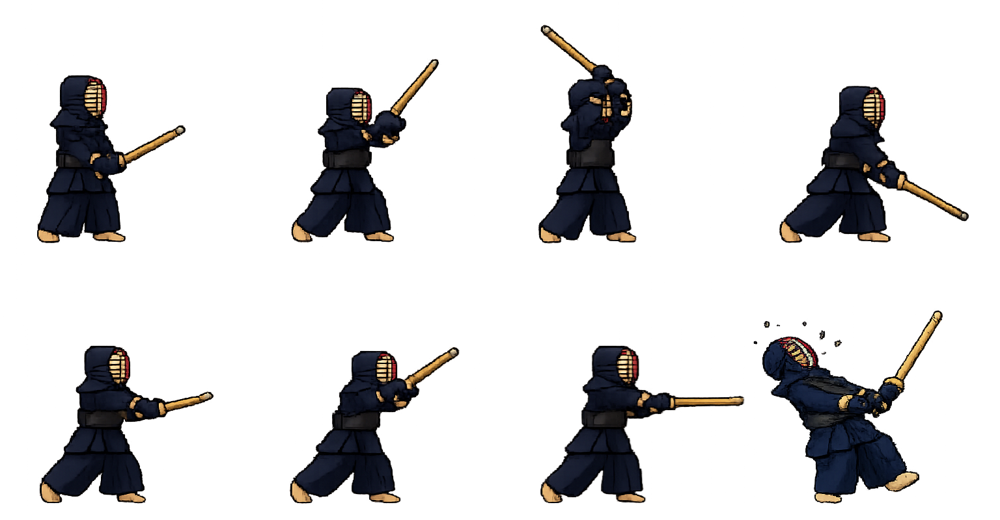
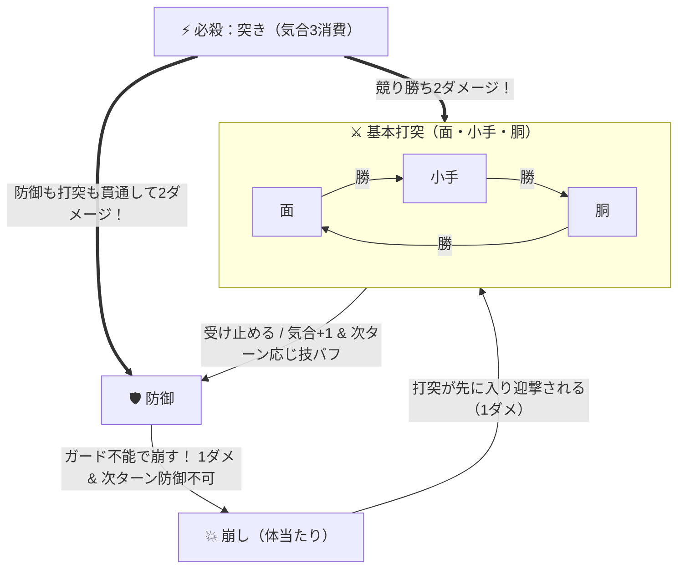

# ⚔️ 剣道 (Kendo)

[](https://rinevo.github.io/Kendo/)
[](https://github.com/rinevo/Kendo)
[](https://rinevo.com)
[](https://developer.mozilla.org/ja/docs/Web/JavaScript)

ブラウザで手軽に遊べる、**読み合いと間合いの駆け引き**をテーマにした剣道対戦ゲームです。  
基本の三すくみ（面・小手・胴）に加え、「防御からの応じ技」「ガードを割る崩し」「気合ゲージを使った必殺の諸手突き」、そして「相手の気配（構えの予兆）」を読む心理戦を楽しめます。

👉 **[GitHub Pages で今すぐプレイする (https://rinevo.github.io/Kendo/)](https://rinevo.github.io/Kendo/)**



---

## ✨ 特徴

- **奥深い駆け引きシステム**
  - 単なるじゃんけんにとどまらない、「🛡️ 防御 → 🔥 応じ技（威力2倍＆相打ち勝ち）」「💥 崩し（防御破壊＆次ターン防御不可）」「⚡ 必殺：突き（防御貫通2ダメージ）」による熱い読み合い。
- **「相手の気配」による心理戦**
  - 戦況（気合MAX・応じ技構え・警戒・前のめりなど）に応じて敵AIの思考傾向が変化し、毎ターン表示される「相手の気配」を手がかりに次の一手を読めます。
- **60fps 滑らかキャンバスアニメーション**
  - スプライトシートの全8コマを繋いだマルチフレーム遷移（構え → 振りかぶり → 踏み込み打突 → 残心）と、イージング補間・クロスフェードによる滑らかなすり足＆打突モーション。
  - 踏み込み時の残像・砂煙パーティクル・竹刀の斬撃軌跡・火花・気合オーラを HTML5 Canvas 上でリアルタイム描画。
- **Web Audio API による効果音合成**
  - 外部音声ファイル不要で、打突・受け止め・鍔迫り合い・防御崩し・必殺の一閃などの効果音をブラウザ内でリアルタイム生成。

---

## 🎮 ルールと技の相性

プレイヤー・相手ともに **体力 5** からスタートし、先に相手の体力を `0` にした方が勝利となります。



### アクション一覧

| アクション | 消費気合 | 効果・特徴 |
| :--- | :---: | :--- |
| **⚔️ 面** | 0 | **「小手」に勝ち**、「胴」に負ける基本打突（1ダメージ / 応じ技時は2ダメージ）。「崩し」も迎撃できる。 |
| **⚔️ 小手** | 0 | **「胴」に勝ち**、「面」に負ける基本打突（1ダメージ / 応じ技時は2ダメージ）。「崩し」も迎撃できる。 |
| **⚔️ 胴** | 0 | **「面」に勝ち**、「小手」に負ける基本打突（1ダメージ / 応じ技時は2ダメージ）。「崩し」も迎撃できる。 |
| **🛡️ 防御** | 0 | 相手の「面・小手・胴」を受け止め、**気合+1 ＆ 次ターン「🔥 応じ技構え」**になる。ただし「崩し」や「突き」には敗れる。 |
| **💥 崩し** | 0 | 相手の**「防御」を突き崩して1ダメージ＋気合+1＋相手を次ターン「💫 体勢崩れ（防御不可）」**にする。基本打突には迎撃される。 |
| **⚡ 突き** | **3** | 気合ゲージが3（MAX）の時に発動可能。**相手の防御や基本打突を貫通して2ダメージ**を与える必殺技。 |

### 状態バッジ
- **🔥 応じ技構え（次打2倍）**：防御成功の次ターンに付与。基本打突がヒットすると **2ダメージ** になり、さらに**同じ技同士の相打ちでも一方的に打ち勝つ**ことができます。
- **💫 体勢崩れ（防御不可）**：防御中に相手の「崩し」を受けた次ターンに付与。体勢が崩れ、1ターンの間「防御」が選択できなくなります。
- **⚡ 気合最高潮（突き可）**：気合ゲージが3溜まり、必殺技「突き」が発動可能な状態です。

---

## 🚀 遊び方・セットアップ

### 🌐 ブラウザで今すぐプレイ（GitHub Pages）

インストール不要で、以下の GitHub Pages URL から直接プレイできます。

- **Play URL**: [https://rinevo.github.io/Kendo/](https://rinevo.github.io/Kendo/)

### 💻 ローカルでの実行方法

外部ライブラリやビルドツールは不要です。リポジトリをクローンして `index.html` を開くだけですぐに動作します。

```bash
git clone https://github.com/rinevo/Kendo.git
cd Kendo
```

クローン後、`index.html` をブラウザで直接開くか、任意のローカルサーバー（VS Code Live Server や `npx serve` など）で起動してください。

---

## 📁 ファイル構成

```text
Kendo/
├── index.html   # ゲーム画面レイアウト・UI構造
├── style.css    # スタイリング・ゲージ演出・レスポンシブ対応
├── game.js      # ゲームロジック・敵AI・60fpsアニメーション＆Web Audio効果音
├── kendo.png    # 剣道キャラクターのスプライトシート（384×400px × 8コマ）
└── README.md    # 本ドキュメント
```

---

## 🛠️ 使用技術

- **HTML5 / CSS3**（Flexbox / Grid レイアウト、カスタムプロパティ、キーフレームアニメーション）
- **Vanilla JavaScript (ES6+)**
- **HTML5 Canvas API**（高DPI対応、イージング補間・クロスフェード・パーティクル＆斬撃エフェクト描画）
- **Web Audio API**（オシレーターによる効果音プロシージャル生成）

---

## 👤 作者・リンク

- **Author**: [rinevo](https://github.com/rinevo)
- **Website**: [https://rinevo.com](https://rinevo.com)
- **GitHub Pages (Demo)**: [https://rinevo.github.io/Kendo/](https://rinevo.github.io/Kendo/)
- **Repository**: [https://github.com/rinevo/Kendo](https://github.com/rinevo/Kendo)

