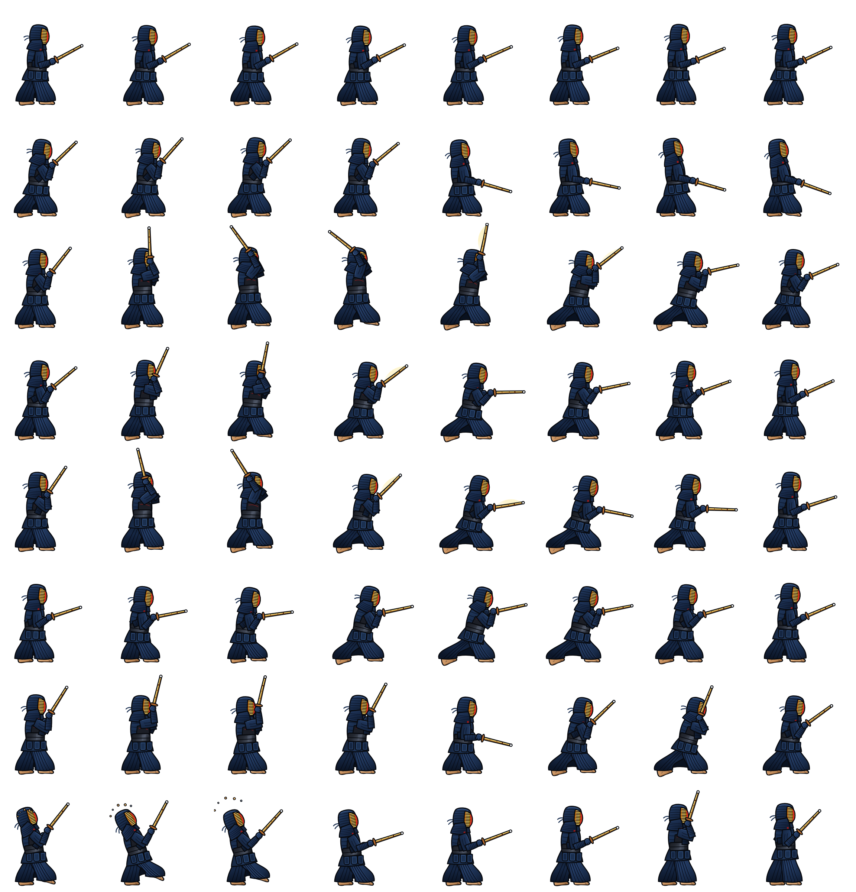
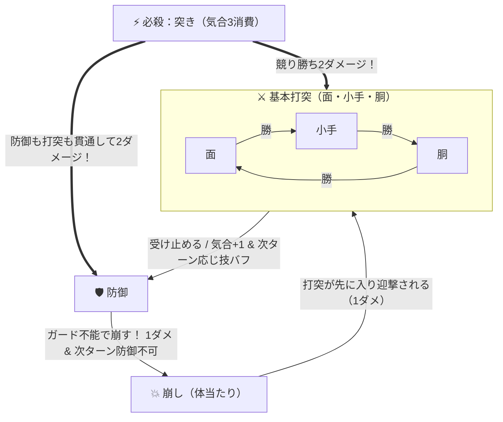

# ⚔️ 剣道 (Kendo)

[](https://rinevo.github.io/Kendo/)
[](https://github.com/rinevo/Kendo)
[](https://rinevo.com)
[](https://developer.mozilla.org/ja/docs/Web/JavaScript)

ブラウザで手軽に遊べる、**読み合いと間合いの駆け引き**をテーマにした剣道対戦ゲームです。  
基本の三すくみ（面・小手・胴）に加え、「防御からの応じ技」「ガードを割る崩し」「気合ゲージを使った必殺の諸手突き」、そして「相手の気配（構えの予兆）」を読む心理戦を楽しめます。

👉 **[GitHub Pages で今すぐプレイする (https://rinevo.github.io/Kendo/)](https://rinevo.github.io/Kendo/)**



---

## ✨ 特徴

- **🙇 「礼に始まり礼に終わる」剣道礼法・蹲踞（そんきょ）アニメーション**
  - **試合開始前（提げ刀）**：試合が始まるまでは、お互いに竹刀を左手に提げた自然体の姿勢（提げ刀）で開始線に立ちます。
  - **試合開始の礼法**：「🙇 礼をして試合開始」ボタンを押すと、お互いに**立礼**をしてから竹刀を抜いて中段に構えつつ**蹲踞（そんきょ）**し、審判の**「🚩 始め！」**の掛け声とともに立ち上がって戦いが始まります。
  - **勝敗決定後の礼法**：どちらかの体力が `0` になって勝敗が決まると、お互いに**中段の構え**に整えてから**蹲踞**し、**竹刀を左腰に収めて（収め刀）から立ち上がり、お互いに礼**をして試合を締めくくります。
- **🏆 勝ち抜き五人掛けモード（個性豊かな5人の剣士＆相手選択）**
  - 先鋒（門下生・健太）から次鋒（小手名人・佐々木）、中堅（剛剣・鬼塚）、副将（幻影・霞）、大将（師範代・龍禅）まで、それぞれ**異なる剣風・最大体力・初期気合・防具（胴）の漆塗りカラー**を持つ5人の剣士と連戦できます（上部のステージバーから任意の相手を指名して対戦することも可能）。
- **🎋 プレイヤー＆敵剣士の『構え（中段・上段・脇構え）』リアルタイム切替システム**
  - プレイヤーはコマンド上部の切替バーから、ターン消費なしでいつでも3つの構え（ポーズ＆性能）を切り替えられます。さらに**対戦相手の敵剣士（先鋒〜大将の5人）も戦況や剣風に応じて構えをリアルタイムに切り替え**、Canvas上の60fps関節補間ポーズ・構えバッジ・オーラ・打突性能・弱点が連動します。
    - **⚖️ 中段の構え（基本・攻守万能）**：すべてのコマンドが使用できる王道の構え。
    - **🔥 上段の構え（火の構え・超攻撃型）**：竹刀を頭上に大きく振りかぶる構え。**「面（上段面）」のダメージが+1強化（通常2ダメ・応じ/引き面は3ダメ）**され、中段・脇構え相手の通常の「面」との**相面（面 vs 面）も一方的に粉砕**します（双方が上段の場合は互角に激突し鍔迫り合いへ！）。代わりに「防御」が不可となり、手元や喉元を狙う**「小手」「突き」被弾時のダメージが+1増加**します（敵が上段に構えた時は「小手」や「突き」で大ダメージを奪うチャンス！）。
    - **🌊 脇構え（水の構え・後の先＆反撃特化）**：竹刀を右脇後方へ低く隠す構え。**「防御（後の先防御）」成功時に気合+2＆体力+1回復＋応じ技準備**を得られ、相手の「崩し」を「胴（抜き胴）」で迎撃した際の威力が2ダメージに強化されます（通常の面打突では気合が増加しません）。
- **💥 鍔迫り合い（つばぜりあい）＆ 引き技モード**
  - 「同じ基本打突同士の交錯（面vs面・小手vs小手・胴vs胴）」や「崩し vs 崩し」が発生すると、火花を散らして至近距離の**「💥 鍔迫り合い状態」**へ突入！
  - 鍔迫り合い中は専用の前傾押し合いポーズになり、コマンドが**「⚡ 引き面・引き小手・引き胴（威力2倍・バックステップ斬撃）」「🛡️ 密着ガード」「💥 突き放し」「⚡ 離れ突き（3ダメージ）」**へ変化します。
- **奥深い駆け引きシステム**
  - 単なるじゃんけんにとどまらない、「🛡️ 防御 → 🔥 応じ技（威力2倍＆相打ち勝ち）」「💥 崩し（防御破壊＆次ターン防御不可）」「⚡ 必殺：突き（防御貫通2ダメージ）」による熱い読み合い。
- **「相手の気配」による心理戦**
  - 戦況（気合MAX・応じ技構え・警戒・前のめりなど）に応じて敵AIの思考傾向が変化し、毎ターン表示される「相手の気配」を手がかりに次の一手を読めます。
- **60fps ヌルっと動く滑らかキャンバスアニメーション ＆ 爽快ヒット演出**
  - 8列×8行（全64コマ）のマルチフレーム・スプライトシートと、2ボーン逆運動学（IK）・布物理（袴・垂・面紐の二次揺れ）による60fps連続関節補間アニメーション（構え → 振りかぶり → 踏み込み打突 → 竹刀のしなり → 残心）。
  - 打突インパクト時の**ヒットストップ＆スローモーション演出**、**審判の紅白旗「🚩一本！」コールカットイン**、**フローティングダメージ＆バフ表示**、**遅延ダメージ赤ゲージ**を搭載。
  - 踏み込み時の連続ポーズ残像・砂煙パーティクル・竹刀の斬撃軌跡・衝撃波リング＆放射閃光・火花・気合オーラ・両足の接地シャドウを HTML5 Canvas 上でリアルタイム描画。
- **Web Audio API によるプロシージャル効果音＆気合声・審判号令合成**
  - 外部音声ファイル不要で、試合開始の審判による短く鋭い号令（**「ハジメッ！」**）および打突時の気迫に満ちた叫び声（**「メェーーーン！」「コテェーーッ！」「ドォーーッ！」「ツキィーーッ！」**）を**声帯波形・呼気摩擦ノイズ・母音フォルマント共鳴フィルタ・喉のサチュレーション・道場残響**を用いてリアルタイムに完全プロシージャル合成。
  - 審判の声は引き締まった男性主審（F0: 約158Hz）の短く明瞭なスタッカート号令として合成され、攻撃を行う剣士の声（中高音シャウト）とは明確に異なる第三者の存在感を演出します。
  - 竹刀の乾いた打突スナップ音（パァン！）・一本時の重厚な和太鼓音（ドン！）・受け止め・鍔迫り合い・防御崩し・必殺の一閃などの効果音もすべてブラウザ内でゼロ遅延生成。相手剣士（健太・佐々木・鬼塚・霞・龍禅）や打突の強さに応じて声質や迫力が変化します。

---

## 🎮 ルールと技の相性

プレイヤー・相手ともに **体力 5** からスタートし、先に相手の体力を `0` にした方が勝利となります。



### アクション一覧

| アクション | 消費気合 | 効果・特徴 |
| :--- | :---: | :--- |
| **⚔️ 面** | 0 | **「小手」に勝ち**、「胴」に負ける基本打突（1ダメージ / 応じ技時は2ダメージ）。「崩し」も迎撃できる。 |
| **⚔️ 小手** | 0 | **「胴」に勝ち**、「面」に負ける基本打突（1ダメージ / 応じ技時は2ダメージ）。「崩し」も迎撃できる。 |
| **⚔️ 胴** | 0 | **「面」に勝ち**、「小手」に負ける基本打突（1ダメージ / 応じ技時は2ダメージ）。「崩し」も迎撃できる。 |
| **🛡️ 防御** | 0 | 相手の「面・小手・胴」を受け止め、**気合+1 ＆ 次ターン「🔥 応じ技構え」**になる。ただし「崩し」や「突き」には敗れる。 |
| **💥 崩し** | 0 | 相手の**「防御」を突き崩して1ダメージ＋気合+1＋相手を次ターン「💫 体勢崩れ（防御不可）」**にする。基本打突には迎撃される。 |
| **⚡ 突き** | **3** | 気合ゲージが3（MAX）の時に発動可能。**相手の防御や基本打突を貫通して2ダメージ**を与える必殺技。 |

### 状態バッジ
- **💥 鍔迫り合い（引き技2ダメ）**：同技交錯または「崩し」同士の衝突で突入。次ターンの基本打突がバックステップしながら斬り抜く**「引き面・引き小手・引き胴（威力2ダメージ）」**に強化され、必殺の突きも**「離れ突き（3ダメージ）」**に強化されます。
- **🔥 応じ技構え（次打2倍）**：防御成功の次ターンに付与。基本打突がヒットすると **2ダメージ** になり、さらに**同じ技同士の相打ちでも一方的に打ち勝つ**ことができます。
- **💫 体勢崩れ（防御不可）**：防御中に相手の「崩し」を受けた次ターンに付与。体勢が崩れ、1ターンの間「防御」が選択できなくなります。
- **⚡ 気合最高潮（突き可）**：気合ゲージが3溜まり、必殺技「突き」が発動可能な状態です。

---

## 🚀 遊び方・セットアップ

### 🌐 ブラウザで今すぐプレイ（GitHub Pages）

インストール不要で、以下の GitHub Pages URL から直接プレイできます。

- **Play URL**: [https://rinevo.github.io/Kendo/](https://rinevo.github.io/Kendo/)

### 💻 ローカルでの実行方法

外部ライブラリやビルドツールは不要です。リポジトリをクローンして `index.html` を開くだけですぐに動作します。

```bash
git clone https://github.com/rinevo/Kendo.git
cd Kendo
```

クローン後、`index.html` をブラウザで直接開くか、任意のローカルサーバー（VS Code Live Server や `npx serve` など）で起動してください。

---

## 📁 ファイル構成

```text
Kendo/
├── index.html          # ゲーム画面レイアウト・UI構造
├── README.md           # 本ドキュメント
├── css/
│   └── style.css       # スタイリング・ゲージ演出・レスポンシブ対応
├── img/
│   ├── dojo-bg.png     # 剣道場の全体背景画像
│   ├── fighter-bg.svg  # 剣士枠の背景（漆喰壁・琥珀色の板張り床・白線）
│   └── kendo.png       # 剣道キャラクターのスプライトシート（288×300px × 64コマ [8列×8行]）
└── js/
    └── game.js         # ゲームロジック・敵AI・60fpsアニメーション＆Web Audio効果音
```

---

## 🛠️ 使用技術

- **HTML5 / CSS3**（Flexbox / Grid レイアウト、カスタムプロパティ、キーフレームアニメーション）
- **Vanilla JavaScript (ES6+)**
- **HTML5 Canvas API**（高DPI対応、イージング補間・クロスフェード・パーティクル＆斬撃エフェクト描画）
- **Web Audio API**（オシレーターによる効果音プロシージャル生成）

---

## 👤 作者・リンク

- **Author**: [rinevo](https://github.com/rinevo)
- **Website**: [https://rinevo.com](https://rinevo.com)
- **GitHub Pages (Demo)**: [https://rinevo.github.io/Kendo/](https://rinevo.github.io/Kendo/)
- **Repository**: [https://github.com/rinevo/Kendo](https://github.com/rinevo/Kendo)

