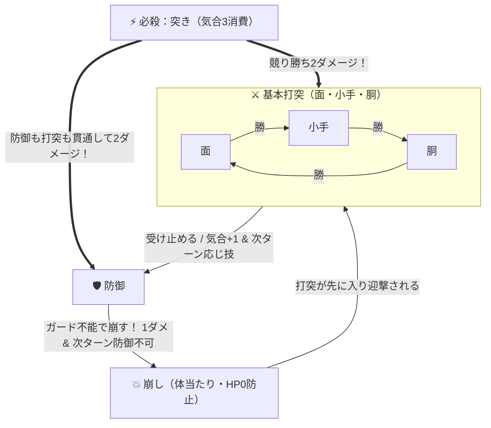

# ⚔️ 剣道 (Kendo) - 高校剣道 激闘の軌跡

[](https://rinevo.github.io/Kendo/)
[](https://github.com/rinevo/Kendo)
[](https://rinevo.com)
[](https://developer.mozilla.org/ja/docs/Web/JavaScript)

ブラウザで手軽に遊べる、**読み合いと間合いの駆け引き**を極限まで追求した本格剣道シミュレーション＆対戦ゲームです。  
基本の三すくみ（面・小手・胴）に、応じ技・体当たり崩し・必殺突き、そして構えの予兆やAIの思考を読む心理戦を楽しめます。

さらに、高校剣道部の主将として個性豊かな部員たちを育て、個人戦・団体戦での全国制覇を目指す**「全国制覇モード」**や、心揺さぶる**BGM音響システム＆プロシージャル音声合成**を完全搭載しています。

👉 **[GitHub Pages で今すぐプレイする (https://rinevo.github.io/Kendo/)](https://rinevo.github.io/Kendo/)**


---

## 📚 詳細ドキュメント目次 (Docs)

機能ごとの詳細なゲーム仕様、イベント一覧、パラメータ設計、および技術アーキテクチャについては、以下の各ドキュメントをご覧ください。

| ドキュメント | 主な内容 | リンク |
| :--- | :--- | :---: |
| 🥋 **全国制覇モード** | 高校部活シミュレーション仕様、4大大会（IH・選抜）、世代交代・セレモニー、高校生部活ライフイベント全20種一覧、全国制覇特典（主将試合の自動化）、オーダー編成・助っ人、8軸レーダーチャート、ミニキャラ連動、防具カラー | [**詳細を見る ➔**](docs/club-mode.md) |
| ⚔️ **一本勝負バトルシステム** | 三すくみ相性図、アクション一覧、構え切替（中段・上段・下段構え）、鍔迫り合い・引き技、適応型AI学習＆見切りカウンター、剣道礼法・蹲踞、五人掛けモード | [**詳細を見る ➔**](docs/battle-system.md) |
| 🛠️ **技術仕様・アーキテクチャ** | ゼロディペンデンシー設計、Single Audio Player BGM制御、Web Audio APIプロシージャル音声・効果音合成、Canvas 60fps描画＆IK・布物理、Glassmorphism＆モバイル最適化 | [**詳細を見る ➔**](docs/technical-spec.md) |

---

## ✨ ゲームのハイライト

### 🏯 2つのゲームモード
1. **🥋 全国制覇モード（高校剣道部 世代交代シミュレーション）**
   - プレイヤーは高校剣道部の主将となり、47都道府県から頂点を目指します。
   - 1ヶ月4週のカレンダー制で部員たちに稽古をつけ、夏のインターハイ（個人戦）や春の全国選抜（団体戦）に出陣！
   - 新歓・引退・新体制発足の世代交代セレモニーや、**全20種の高校生部活ライフ専用イラストイベント**を収録。全国大会優勝後は**主将試合の自動化（オート観戦・即時判定）**が解放！
2. **🏆 勝ち抜き五人掛けモード（アーケード個人連戦）**
   - 先鋒から大将（師範代）まで、異なる剣風と防具カラーを持つ5人の猛者と勝ち抜き一本勝負！

### ⚔️ 読み合いと間合いの「三すくみ」バトル
基本の打突（面・小手・胴）はじゃんけんの三すくみ関係にあり、さらに「防御」と「崩し（体当たり）」、必殺の「突き」が絡み合う奥深い駆け引きが展開されます。



- **構え切替**: 中段（万能）、上段（超攻撃型・面強化）、下段の構え（後の先・胴強化）をいつでもチェンジ。
- **鍔迫り合い**: 打突衝突で密着状態へ移行し、威嚇・突き放し・引き技の近接戦へ。
- **適応型AI**: ワンパターンな防御や攻撃を繰り返すと、相手が学習して裏をかく見切りカウンターを発動！

### 🎵 臨場感を極める音響 ＆ 映像演出
- **シチュエーション別BGM**: 道場稽古、大会、立ち合い、優勝表彰式まで専用BGMが滑らかにクロスフェード。
- **完全合成の審判号令**: Web Audio APIフォルマント合成により、「ハジメッ！」「一本！」の音声をブラウザ単体でリアルタイム生成。
- **Canvas 60fps アニメーション**: 竹刀のしなり、2ボーンIK、道着や袴の布揺れ、火花パーティクルを描画。

---

## 🚀 クイックスタート・ローカル実行

### 🌐 ブラウザで遊ぶ
インストール不要で、以下のURLからすぐにお楽しみいただけます。  
👉 **[https://rinevo.github.io/Kendo/](https://rinevo.github.io/Kendo/)**

### 💻 ローカルで動かす
外部ライブラリやビルドツール（npm等）のインストールは一切不要です。

```bash
# 1. リポジトリをクローン
git clone https://github.com/rinevo/Kendo.git
cd Kendo

# 2. ブラウザで開く（ダブルクリックまたはローカルサーバー）
# 例: VS Code Live Server や任意のエグゼキュータで index.html を開く
```

---

## 📁 プロジェクト構成

```text
Kendo/
├── index.html                      # ゲームメインUI・画面コンテナ
├── README.md                       # プロジェクト概要（本ファイル）
├── docs/                           # 詳細仕様ドキュメント群
│   ├── club-mode.md                # 🥋 全国制覇モード仕様書
│   ├── battle-system.md            # ⚔️ 一本勝負バトルシステム仕様書
│   └── technical-spec.md           # 🛠️ 技術仕様・アーキテクチャ詳細
├── bgm/                            # 画面連動BGM（MP3）
│   ├── Bare_Feet_on_Polished_Pine.mp3  # 練習メニュー・ダッシュボードBGM
│   ├── Before_the_Strike.mp3       # タイトル画面BGM
│   ├── Gold_in_the_Dojo.mp3        # 大会優勝表彰式BGM
│   ├── Stance_and_Steel.mp3        # 立ち合い（試合）BGM
│   └── The_Sunlit_Dojo.mp3         # 大会閉会式BGM
├── css/
│   └── style.css                   # すりガラスUI・大会背景・レスポンシブスタイル
├── img/
│   ├── arena-district-gym.png      # 地区予選大会背景
│   ├── arena-national-kasugai.png  # 全国選抜大会背景
│   ├── ceremony/                   # 式典・表彰・世代交代イラスト群
│   ├── dojo-bg.png                 # 剣道場全体背景
│   ├── event/                      # 高校生部活ライフイベントイラスト群（全20種・PNG）
│   ├── fighter-bg.svg              # 剣士枠背景
│   ├── kachinukiimage.png          # 五人掛けモード紹介画像
│   └── kendo.png                   # 剣士スプライトシート（64コマ）
└── js/
    ├── bgm.js                      # Single Audio Player BGMマネージャー
    ├── club.js                     # 部活・カレンダー・大会・イベント進行管理
    └── game.js                     # バトルエンジン・Canvas 60fps描画・Web Audio合成
```

---

## 🛠️ 使用技術

- **Vanilla JavaScript (ES6+)**: フレームワーク非依存の軽量設計
- **HTML5 Canvas API**: 関節IK補間、布物理、パーティクル、高解像度描画
- **Web Audio API**: 審判号令・気合声のフォルマント合成、竹刀打突音のノイズ生成
- **HTML5 Audio API**: シームレスなBGMクロスフェード制御
- **Modern CSS3**: Glassmorphism、Flexbox/Grid、Safe Area・モバイル完全対応

---

## 👤 作者・リンク

- **Author**: [rinevo](https://github.com/rinevo)
- **Website**: [https://rinevo.com](https://rinevo.com)
- **GitHub Pages (Demo)**: [https://rinevo.github.io/Kendo/](https://rinevo.github.io/Kendo/)
- **Repository**: [https://github.com/rinevo/Kendo](https://github.com/rinevo/Kendo)
