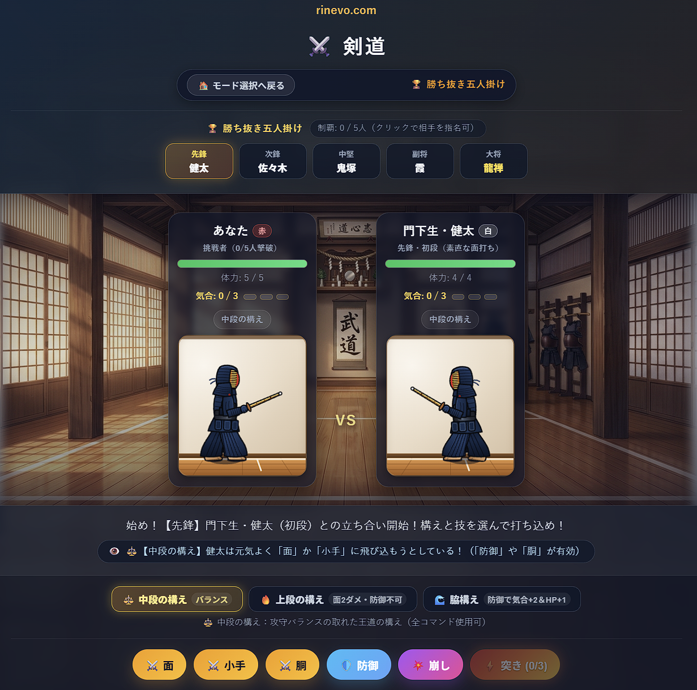
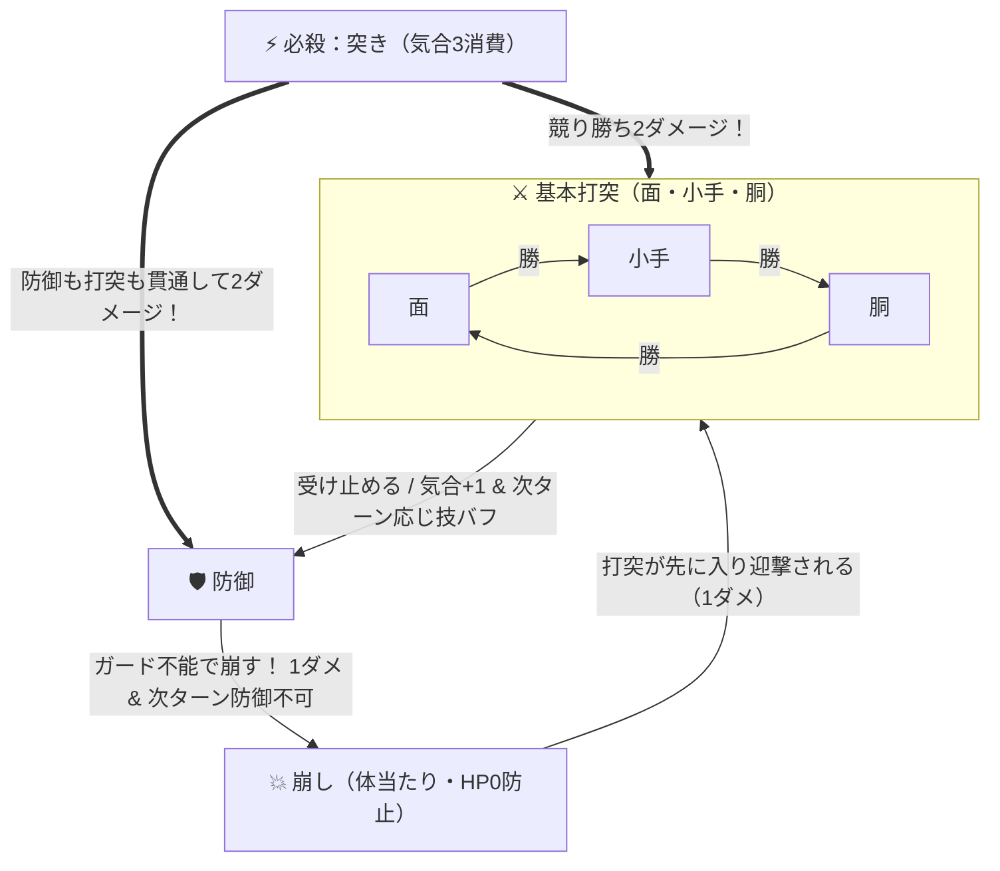

# ⚔️ 剣道 (Kendo)

[](https://rinevo.github.io/Kendo/)
[](https://github.com/rinevo/Kendo)
[](https://rinevo.com)
[](https://developer.mozilla.org/ja/docs/Web/JavaScript)

ブラウザで手軽に遊べる、**読み合いと間合いの駆け引き**をテーマにした剣道対戦ゲームです。  
基本の三すくみ（面・小手・胴）に加え、「防御からの応じ技」「ガードを割る崩し」「気合ゲージを使った必殺の諸手突き」、そして「相手の気配（構えの予兆）」を読む心理戦を楽しめます。  
さらに、高校剣道部の主将として部員を育てて個人戦・団体戦での全国制覇を目指す**「団体戦・全国制覇モード」**、そして臨場感あふれる**BGM音響システム**も搭載しています。

👉 **[GitHub Pages で今すぐプレイする (https://rinevo.github.io/Kendo/)](https://rinevo.github.io/Kendo/)**



---

## ✨ 特徴

### 🏯 2つのゲームモード（モード選択画面）
ゲーム起動時のタイトル画面で、プレイスタイルに合わせた2つのモードから選択できます。ヘッダーの「🔄 モード選択へ戻る」ボタンからいつでも切り替え可能です。

1. **🥋 団体戦・全国制覇モード（高校剣道部 世代交代シミュレーション）**
   - **創部と初期設定**：学校名・主将名・所在地（47都道府県）を自由に設定してスタート（ランダム初期値付き）。プレイヤーは「2年生主将」として部を率います。
   - **4週制カレンダーと4大公式大会（個人戦・団体戦）**：1年目4月1週から開始し、1ヶ月4週で進行。
     - **6月1週【インターハイ（全国高校総体）都道府県個人予選】**：主将＋部内最強選手（最大2名）が代表として出場する16名トーナメント。上位入賞で8月の全国高校総体への切符を獲得！
     - **8月1週【全国高校総体（インターハイ）個人戦】**：全国の予選を勝ち抜いた精鋭が集う32名トーナメント。全国の猛者たちと個人日本一をかけて激突！
     - **12月3週【選抜地区予選（団体戦）】**：選択した都道府県の代表を決める5人制団体トーナメント。優勝校のみが全国選抜への切符を獲得！
     - **3月4週【全国高校剣道選抜大会（団体戦）】**：各都道府県の代表47校が集う全国トーナメント。愛知県春日井市総合体育館の舞台で日本一を目指して激突！
   - **世代交代と新入部員 ＆ 出場オーダー自動配置ルール**：
     - **4月1週（新年度・新入部員配置）**：2年➔3年、1年➔2年に進級。直近の大会成績に応じた人数の新1年生が入部（ランダム生成）。新1年生が入部した際は、**先鋒、次鋒、中堅の順で自動的にオーダーへ割り当て**られます（主将は大将を維持、上級生が副将等へ配置）。
     - **9月1週（引退と新主将任命・大将就任）**：3年生が引退し、2年生部員の中から**プレイヤーが新主将を指名**。新主将を任命した際は、**新主将が確実に大将スロットへ割り当て**られ（元の部員と自動スワップ）、新たなプレイヤーとして部を率いて歴史を紡ぎます。
   - **👥 出場オーダーの横スクロール表示 ＆ 左側控え部員表示**：
     - ダッシュボードの部員一覧は**横スクロール（スワイプ・スクロールバー・◀/▶ナビボタン対応）**でスムーズに閲覧可能。
     - **左側に控え部員（ベンチメンバー）カードを整然と配置**し、区切り線（`出場オーダー ➔`）を挟んで右側に先鋒・次鋒・中堅・副将・大将のオーダー部員が並びます。
     - 控え部員もレギュラー部員と同様に、8軸レーダーチャート、調子、疲労度、防具カラー、そして生きたミニキャラアニメーション（練習連動）が完全に表示されます。
   - **🔄 オーダー編成における控え部員の選択・起用システム**：
     - 「🔄 オーダー編成を変更する」画面において、先鋒〜大将の各スロット内に**選手変更セレクトメニュー**を新設。現在のオーダー選手だけでなく**控え部員も自由に選択して即座にスワップ・起用**できます。
     - オーダー画面下部には**「👥 控え部員一覧」セクション**を展開。各控え部員カードに配置先ボタン（`[先鋒] [次鋒] [中堅] [副将] [大将]`）が備わっており、ワンクリックで狙ったポジションへ抜擢可能（元いた選手は自動的に控えへ移行）。
     - 欠員枠（選手不足スロット）がある場合も、控え部員から直接選んで埋めることができます。
   - **部員5名未満の出場制限＆助っ人勧誘システム**：
     - 団体戦（先鋒・次鋒・中堅・副将・大将の5名構成）には5名以上の部員が必要です。5名未満で大会週を迎えた場合は「部員不足不出場」として公式年表に記録されます（個人戦は部員がいれば出場可能）。
     - 部員不足時は、他部（陸上部・柔道部・野球部・吹奏楽部・卓球部・将棋部）から助っ人を最大5名まで勧誘可能（掛け持ち入部・隠し成長率50%）。
   - **部員パラメータ・才能限界値・隠し成長率・上限99設定**：
     - 部員の能力値（腕力・敏捷・気魄）および技パラメータ（面・小手・胴・突き）の上限は `99`、体力の上限は `8`。
     - 部員ごとに内部パラメータとして**「才能限界値」**が設定されており、才能限界値に到達した後は稽古による能力上昇率が `1/2` に減衰します。
     - **部員ごとの隠し成長率**：通常部員は `80%〜120%` の範囲で一人ひとり異なる隠し成長率を持ち、部員ごとの成長の個性を演出。助っ人部員は `50%`（すべて画面上は非表示の隠しパラメータ）。
     - 剛腕パワー型、韋駄天スピード型、不動心気魄型など7種類の個性アーキタイプを搭載。
   - **マンツーマン特別指導の選択保持**：
     - 前回指導した部員の選択状態が翌週以降も保持され、継続的な集中育成がスムーズに行えます。
   - **📊 各部員パラメーターの『8軸レーダーチャート (SVG)』表示**：
     - 身体能力（**体力・腕力・敏捷・気魄**）と打突技術（**面・小手・胴・突き**）の全8項目を視認性の高い幾何学レーダーチャート上にプロット。
     - 体力は最大目盛り `8`、その他パラメータは基準目盛り `50` で描画。50を超えると炎オーラとともに枠を突き抜けて限界突破表示されます。
   - **🥋 部員カード内のミニキャラ表示・生きたアニメーション ＆ 練習メニュー連動**：
     - 各部員カード（およびオーダー編成画面）の下部に、**試合中画像のちょうど半分サイズ（91×100px）の剣道ミニキャラ**を配置。
     - **常時アニメーション**：ミニ道場床の上で、部員たちが呼吸で胸を上下させ、すり足で前後に揺らぎながら生き生きとアニメーションします。各部員の呼吸リズムには自然なズレを持たせ、本物の道場のような臨場感を演出。
     - **練習メニュー連動モーション**：練習メニューをクリックした際、各部員の**得意な構えを表示した状態から**3秒間だけ各メニューに応じたアニメーションが始動します。
        - **🏃 すり足・基礎体力**：得意な構えから軽快な送り足ステップと腰の上下動を繰り返す。
        - **⚔️ 素振り・基本打ち込み**：得意構えから竹刀を頭上高く振りかぶり、鋭く振り下ろして面を打突する素振りモーション。
        - **🔥 追い込み・掛かり稽古**：得意構えから前傾姿勢で踏み込み、鋭い面・小手・胴の連続打ちと鍔迫り合い体当たりを猛スピードで繰り出す。
        - **🧘 座禅・見取り稽古（蹲踞）**：得意な構えから腰を低く落として背筋を伸ばす「蹲踞」の姿勢を取り、静かに深呼吸を行う所作を**1回だけアニメーション**し、その後は得意な構えを表示します。
        - **🍵 休養・道具手入れ（納刀）**：得意な構えから竹刀を左腰へとスッと収めて息を整え、抜刀して構えへ戻る「納刀」の所作を**1回だけアニメーション**し、その後は得意な構えを表示します。
        - **🥋 主将によるマンツーマン特別指導**：主将と指名された部員の2名のみが、**ランダムで試合中と同等の迫力ある攻撃アニメーション（面・小手・胴・突き）**をダイナミックに繰り広げ、他の選手は各自の得意構えで静かに待機。
      - **3秒間動作＆未選択状態への復帰**：練習メニューは選択状態を維持するのではなく、クリック時のみ3秒間アニメーションが熱気あふれる演出とともに動作し、効果反映後は常にすっきりとした未選択状態（ボタンは未選択、部員は得意構え待機）へ戻ります。マウスオーバーによるアニメーションの誤変化は発生しません。部員カード上部には動作中に「🏃 すり足稽古」「🧘 蹲踞」「🍵 納刀休養」「🥋 特訓打突 (面打ち/小手打ち/胴打ち/諸手突き)」等の個別バッジを表示。
     - **個性豊かな防具カラー（試合連動）**：剣道の防具（胴の漆塗り・胸革・胸刺し糸・垂飾り糸）は部員ごとに個性豊かなカラーテーマ（**黒漆塗、溜塗、紺ピ藍塗、織部翠漆、紫紺塗、琥珀飴色、曙塗、燻し銀塗、真朱漆、浅葱青磁、鉄紺塗、黄金梨地**）が割り当てられます。
     - **防具の色は試合中にも完全連動**し、リアルタイム観戦や主将実戦で該当部員が試合場に立った際も、部員カードと同じ固有の防具色で戦います。
   - **📌 学校名と次の重要日程の画面上部固定表示（スティッキーヘッダー）**：
     - 画面を縦スクロールして部員カード、練習メニュー、部活動日誌などを閲覧する際も、「学校名・所在地・現主将・年週」枠と「次の重要日程・大会出陣ボタン」枠が画面最上部に常時固定（sticky）表示されます。
     - 背景のすりガラス効果（`backdrop-filter: blur(10px)`）と上品な透過グラデーションにより、スクロールで通過する部員カードの視認性を損なうことなく、現在の学校ステータスや大会日程が常にひと目で確認できます。
   - **📱 大画面・狭画面対応 ＆ 縦位置中央・安全上寄せレスポンシブ配置**：
     - **大画面・ワイド表示対応**：ゲームウィンドウは最大幅 `min(1480px, 96vw)` に拡大最適化され、広いディスプレイでもゆったりと迫力あるレイアウトで楽しめます。
     - **縦位置中央揃え ＆ 自動上寄せ切り替え**：画面全体の高さに余裕がある場合は美しい垂直中央配置となり、ブラウザの画面がゲームウィンドウよりも狭い（低い）場合は自動的に上寄せ配置（`justify-content: safe center;` ＆ `margin: auto;`）へと切り替わり、ヘッダー等の上部が見切れることなくスムーズに下スクロールが可能です。
     - スマートフォンやタブレットなどの狭小幅でもウィンドウが柔軟にフィットし、快適にプレイできます。
   - **👀 スコアボード3秒インターバル付きリアルタイム連続観戦**：
     - 団体戦で「👀 リアルタイム観戦」を押すと、先鋒戦から大将戦（主将の出番）までノンストップで連続観戦可能。個人戦でも代表部員の熱戦をリアルタイム観戦できます。
     - **1試合終了ごとに必ずスコアボード画面を表示**し、最新の勝敗判定や実況ログを確認可能。
     - スコアボード上で**「3秒後に自動で立ち合いを開始します…」**のカウントダウンが行われ、操作なしで自動的に次の仲間の試合へ進みます。
     - 「▶️ 今すぐ観戦開始」「⏸️ 観戦を一時停止」「⏩ 主将の出番までスキップ」も自由に行えます。
     - 主将（大将戦）の出番に到達した際は自動カウントダウンを行わず、スコアボードで安全に停止して「⚔️ 立ち合い開始」ボタンが表示されます。
   - **厳格オートセーブ＆歴代戦績記録**：
     - 稽古・大会・試合結果は即座にローカルストレージへ自動保存。「▶️ 続きから始める」でいつでも再開できます。

2. **🏆 勝ち抜き五人掛けモード（アーケード個人連戦）**
   - 先鋒（門下生・健太）から次鋒（小手名人・佐々木）、中堅（剛剣・鬼塚）、副将（幻影・霞）、大将（師範代・龍禅）まで、それぞれ異なる剣風・体力・気合・防具カラーを持つ5人の剣士と勝ち抜き連戦を行います（上部ステージバーから個別指名対戦も可能）。

---

### 🎵 臨場感を高めるBGM ＆ 音響コントロール
画面シチュエーションに応じたオリジナルBGMが鳴り響き、真剣勝負と道場の空気感をダイナミックに演出します。

- **シチュエーション別BGM**：
  - **タイトル画面**：`Before_the_Strike.mp3`（決戦前の静かな高揚感・1回のみ再生）
  - **部活・練習メニュー画面**：`Bare_Feet_on_Polished_Pine.mp3`（研ぎ澄まされた道場での稽古・ループ再生）
  - **試合中（立ち合い）**：`Stance_and_Steel.mp3`（緊迫の竹刀の交錯と間合いの駆け引き・ループ再生）
  - **大会優勝・表彰式**：`Gold_in_the_Dojo.mp3`（全国制覇・栄光を讃える旋律・1回のみ再生）
  - **大会準優勝・入賞表彰式**：`The_Sunlit_Dojo.mp3`（健闘と次への誓いを紡ぐ温かな旋律・1回のみ再生）
  - **試合結果（勝敗表）**：BGMを完全停止（実況ログと結果に集中する無音設計）
- **単一プレイヤー設計（Single Audio Player）**：
  - 同時に複数のBGMが重なって再生されるトラブルを物理的に完全防止。
  - シーン切り替え時のフェードイン／フェードアウトによる滑らかな移行。
- **音響コントロールバー**：
  - ヘッダー右上に音量スライダー（0%〜100%）とミュート切り替えボタンを常設。設定値は `localStorage` に自動保存され、次回起動時も保持されます。
  - ブラウザの自動再生制限（Autoplay Policy）に配慮し、初回クリック・タップ等のインタラクション連動で安全に再生開始します。

---

### 🏛️ 開会式・表彰式・賞状授与演出
4大公式大会の開幕および閉幕時には、臨場感あふれる式典演出が展開されます。

- **開会式（オープニング）**：
  - 大会開幕時、大会名・開催会場（高校体育館、春日井市総合体育館等）・カテゴリー・スローガンを配した厳粛なオープニングビジュアルが表示され、大会への士気を高めます。
- **表彰式（クロージング）＆ 賞状授与**：
  - 大会終了後、成績（優勝、準優勝、第3位・ベスト4、敢闘賞・ベスト8など）に応じた美麗な式典アートと専用BGMが流れ、学校名・主将名が毛筆風に刻まれた本格的な「表彰状」が授与されます。
  - 大会での成績に応じて、出場した全部員に能力値ボーナスが付与されます。

---

### 🏟️ 大会専用高精細背景 ＆ 全面演出反映
大会の舞台に応じて、実戦アリーナおよびブラウザ全体の背景（`body`）が動的に変化します。

- **地区予選大会（毎年12月3週）**：
  - 高校の体育館の木製フローリング、バスケットゴール、窓から差し込む陽光、コートテープが貼られた白熱の試合風景（`img/arena-district-gym.png`）。
- **全国高校剣道選抜大会（毎年3月4週）**：
  - 会場である**愛知県春日井市の春日井市総合体育館**の広大なドームメインアリーナ、特徴的なアーチトラス天井、大型吊り下げ照明、観客席、並び立つ白線試合場コート（`img/arena-national-kasugai.png`）。
- 大会終了後は、趣のある通常の道場背景（`img/dojo-bg.png`）へとスムーズに自動復帰します。
- 試合中の役職バッジおよび勝負ありのコールアウトには、プレイヤーが設定した任意の学校名（例: `桜華学園高校`）が正しく反映されます。

---

### 🎋 構え（中段・上段・脇構え）リアルタイム切替システム
プレイヤーはコマンド上部の切替バーから、ターン消費なしでいつでも構えを切り替えられます。対戦相手の敵剣士も戦況や剣風に応じて構えをリアルタイムに切り替え、ポーズ・打突性能・弱点が連動します。

- **⚖️ 中段の構え（基本・攻守万能）**：すべてのコマンドが使用できる王道の構え。
- **🔥 上段の構え（火の構え・超攻撃型）**：竹刀を頭上に大きく振りかぶる構え。「面（上段面）」のダメージが+1強化（通常2ダメ・応じ/引き面は3ダメ）され、相面（面 vs 面）も一方的に粉砕します（双方が上段の場合は鍔迫り合いへ）。代わりに「防御」が不可となり、「小手」「突き」被弾時のダメージが+1増加します。
- **🌊 脇構え（水の構え・後の先＆反撃特化）**：竹刀を右脇後方へ低く隠す構え。「防御（後の先防御）」成功時に気合+2＆体力+1回復＋応じ技準備を得られ、相手の「崩し」を「胴（抜き胴）」で迎撃した際の威力が2ダメージに強化されます。

---

### 💥 鍔迫り合い（つばぜりあい）＆ 引き技モード
- 基本打突同士の交錯（面vs面・小手vs小手・胴vs胴）や「崩し vs 崩し」が発生すると、火花を散らして至近距離の**「💥 鍔迫り合い状態」**へ突入！
- 鍔迫り合い中は専用の前傾押し合いポーズになり、コマンドが**「⚡ 引き面・引き小手・引き胴（威力2倍・バックステップ斬撃）」「🛡️ 密着ガード」「💥 突き放し」「⚡ 離れ突き（3ダメージ）」**へ変化します。

---

### 🛡️ 「崩し」技のHP最低値保証 ＆ 奥深い駆け引き
- **「崩し」ではHP0にならない仕様**：
  - 剣道の崩し（体当たり）は相手の防御をこじ開ける戦術技であり、決め技ではないため、**「崩し」でHPを0にすることはできません（最低でもHP1で踏みとどまります）**。
  - 相手HPが1のときに崩しを成功させても「HP1 耐え！」となり、次ターンの打突（一本）で仕留める緊迫感のある攻防が生まれます（自身が崩しを受けた際も同様にHP1で耐えます）。
- **心理戦と三すくみ**：
  - 「🛡️ 防御 → 🔥 応じ技（威力2倍＆相打ち勝ち）」「💥 崩し（防御破壊＆次ターン防御不可）」「⚡ 必殺：突き（防御貫通2ダメージ）」。
  - 敵AIの思考傾向や「相手の気配」を手がかりに次の一手を読む熱い心理戦が楽しめます。

---

### 🙇 「礼に始まり礼に終わる」剣道礼法・蹲踞アニメーション
- **試合開始前（提げ刀）**：開始線でお互いに竹刀を左手に提げた自然体で対峙。
- **試合開始の礼法**：「🙇 礼をして試合開始」ボタンで立礼 ➔ 帯刀・抜刀 ➔ **蹲踞（そんきょ）** ➔ 審判の**「🚩 始め！」**の号令で立ち上がって試合開始。
- **勝敗決定後の礼法**：勝敗決定後、中段の構え ➔ 蹲踞 ➔ **納刀** ➔ 立ち上がってお互いに立礼をして終了。

---

### ⚡ 60fps キャンバスアニメーション ＆ プロシージャル音声合成
- **Canvas 60fps 関節アニメーション**：
  - 8列×8行（全64コマ）のスプライトシート、2ボーン逆運動学（IK）、布物理（袴・垂・面紐の二次揺れ）による滑らかな関節補間。
  - ヒットストップ、スローモーション、審判コール演出、残像エフェクト、火花・砂煙パーティクル。
- **Web Audio API によるプロシージャル効果音＆音声合成**：
  - 外部音声ファイル不要。審判の号令（**「ハジメッ！」**）や打突時の気合声（**「メェーーーン！」「コテェーーッ！」「ドォーーッ！」「ツキィーーッ！」**）を声帯波形・呼気ノイズ・母音フォルマント共鳴フィルタによりブラウザ内で完全リアルタイム合成。
  - 竹刀の打突スナップ音（パァン！）、一本の和太鼓音（ドン！）、鍔迫り合いの金属音などもゼロ遅延で生成されます。

---

## 🎮 ルールと技の相性

プレイヤー・相手ともに開始時の体力からスタートし、先に相手の体力を `0` にした方が勝利となります。



### アクション一覧

| アクション | 消費気合 | 効果・特徴 |
| :--- | :---: | :--- |
| **⚔️ 面** | 0 | **「小手」に勝ち**、「胴」に負ける基本打突（1ダメージ / 応じ技時は2ダメージ）。「崩し」も迎撃できる。上段時は2ダメージ。 |
| **⚔️ 小手** | 0 | **「胴」に勝ち**、「面」に負ける基本打突（1ダメージ / 応じ技時は2ダメージ）。「崩し」も迎撃できる。上段相手に特効。 |
| **⚔️ 胴** | 0 | **「面」に勝ち**、「小手」に負ける基本打突（1ダメージ / 応じ技時は2ダメージ）。「崩し」も迎撃できる。脇構え時は抜き胴強化。 |
| **🛡️ 防御** | 0 | 相手の「面・小手・胴」を受け止め、**気合+1 ＆ 次ターン「🔥 応じ技構え」**になる。ただし「崩し」や「突き」には敗れる（上段時は使用不可）。 |
| **💥 崩し** | 0 | 相手の**「防御」を突き崩して1ダメージ＋気合+1＋相手を次ターン「💫 体勢崩れ（防御不可）」**にする（※崩しではHPを0にできず最低HP1で耐える）。基本打突には迎撃される。 |
| **⚡ 突き** | **3** | 気合ゲージが3（MAX）の時に発動可能。**相手の防御や基本打突を貫通して2ダメージ**を与える必殺技。上段相手に特効。 |

### 状態バッジ
- **💥 鍔迫り合い（引き技2ダメ）**：同技交錯または「崩し」同士の衝突で突入。基本打突がバックステップ斬撃**「引き面・引き小手・引き胴（威力2ダメージ）」**、突きが**「離れ突き（3ダメージ）」**に強化されます。
- **🔥 応じ技構え（次打2倍）**：防御成功の次ターンに付与。基本打突がヒットすると **2ダメージ** になり、同じ技同士の相打ちでも一方的に打ち勝ちます。
- **💫 体勢崩れ（防御不可）**：防御中に相手の「崩し」を受けた次ターンに付与。1ターンの間「防御」が選択できなくなります。
- **⚡ 気合最高潮（突き可）**：気合ゲージが3溜まり、必殺技「突き」が発動可能な状態です。

---

## 🚀 遊び方・セットアップ

### 🌐 ブラウザで今すぐプレイ（GitHub Pages）
インストール不要で、以下の GitHub Pages URL から直接プレイできます。

- **Play URL**: [https://rinevo.github.io/Kendo/](https://rinevo.github.io/Kendo/)

### 💻 ローカルでの実行方法
外部ライブラリやビルドツールは不要です。リポジトリをクローンしてブラウザで開くだけですぐに動作します。

```bash
git clone https://github.com/rinevo/Kendo.git
cd Kendo
```

クローン後、`index.html` をブラウザで直接開くか、任意のローカルサーバー（VS Code Live Server や `npx serve` など）で起動してください。

---

## 📁 ファイル構成

```text
Kendo/
├── index.html                      # ゲーム画面レイアウト・モード選択・UI構造
├── README.md                       # 本ドキュメント
├── bgm/                            # 画面連動BGMオーディオファイル
│   ├── Bare_Feet_on_Polished_Pine.mp3  # 練習メニュー・ダッシュボードBGM（ループ）
│   ├── Before_the_Strike.mp3       # タイトル画面BGM
│   ├── Gold_in_the_Dojo.mp3        # 大会優勝・表彰状表示BGM
│   ├── Stance_and_Steel.mp3        # 試合中BGM（ループ）
│   └── The_Sunlit_Dojo.mp3         # 大会終了・表彰状表示BGM（準優勝・入賞等）
├── css/
│   └── style.css                   # スタイリング・レーダーチャート・大会背景・式典演出
├── img/
│   ├── arena-district-gym.png      # 地区大会（高校体育館）専用背景画像
│   ├── arena-national-kasugai.png  # 全国大会（春日井市総合体育館）専用背景画像
│   ├── ceremony/                   # 開会式・表彰式専用アート画像群（21ファイル）
│   ├── dojo-bg.png                 # 剣道場の全体背景画像
│   ├── fighter-bg.svg              # 剣士枠の背景（漆喰壁・琥珀色の板張り床・白線）
│   ├── kachinukiimage.png          # タイトル画面・五人掛けモード紹介画像
│   └── kendo.png                   # 剣道キャラクターのスプライトシート（288×300px × 64コマ）
└── js/
    ├── bgm.js                      # BGMマネージャー（単一プレイヤー・音量調節・自動再生制限対応）
    ├── club.js                     # 団体戦・全国制覇モード（カレンダー進行・個人戦/団体戦・式典進行）
    └── game.js                     # ゲームエンジン・バトルロジック・60fpsアニメーション＆音声合成
```

---

## 🛠️ 使用技術

- **HTML5 / CSS3**（Flexbox / Grid レイアウト、safe center 垂直中央配置、SVG レーダーチャート、CSS カスタムプロパティ、アニメーション）
- **Vanilla JavaScript (ES6+)**
- **HTML5 Canvas API**（高DPI対応、関節IK補間・クロスフェード・パーティクル＆斬撃エフェクト描画）
- **Web Audio API**（オシレーター・ノイズ・フォルマントフィルタによる効果音・掛け声プロシージャル生成）
- **HTML5 Audio API**（画面連動BGM再生エンジン、シングルプレイヤー制御、ローカルストレージ永続化）

---

## 👤 作者・リンク

- **Author**: [rinevo](https://github.com/rinevo)
- **Website**: [https://rinevo.com](https://rinevo.com)
- **GitHub Pages (Demo)**: [https://rinevo.github.io/Kendo/](https://rinevo.github.io/Kendo/)
- **Repository**: [https://github.com/rinevo/Kendo](https://github.com/rinevo/Kendo)
