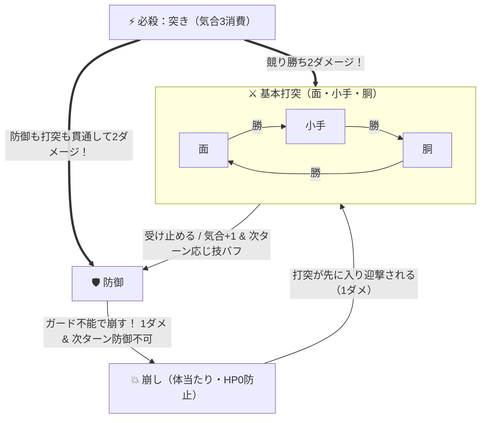

# ⚔️ バトルシステム ＆ 技の駆け引き 詳細ガイド

[⬅️ README（トップ）へ戻る](../README.md) ｜ [🥋 全国制覇モード詳細](club-mode.md) ｜ [🛠️ 技術仕様](technical-spec.md)

---

## 1. バトルシステムの基本原則
本作の試合は、剣道の真髄である「一本勝負の緊張感」と「読み合いの駆け引き」を再現したターン制バトルです。  
互いに開始時の体力（HP）を持ち、先に相手の体力を `0` にした側が勝利（一本）となります。

---

## 2. アクション一覧と詳細性能

| コマンド | 消費気合 | 性能と詳細仕様 |
| :--- | :---: | :--- |
| **⚔️ 面** | 0 | **「小手」に勝ち**、「胴」に負ける基本打突。通常1ダメージ（応じ技時は2ダメージ）。「崩し」も上から叩いて迎撃可能。上段の構え時は威力が2ダメージに強化。 |
| **⚔️ 小手** | 0 | **「胴」に勝ち**、「面」に負ける基本打突。通常1ダメージ（応じ技時は2ダメージ）。「崩し」を迎撃可能。上段の構えをとる相手に対して特効（ダメージ+1）。 |
| **⚔️ 胴** | 0 | **「面」に勝ち**、「小手」に負ける基本打突。通常1ダメージ（応じ技時は2ダメージ）。「崩し」を迎撃可能。脇構え時は「抜き胴」として迎撃威力が2ダメージに強化。 |
| **🛡️ 防御** | 0 | 相手の「面・小手・胴」を受け止めて無効化し、**気合+1 ＆ 次ターン「🔥 応じ技構え」**になる。ただし「崩し」や必殺「突き」には無力（上段の構え中は使用不可）。 |
| **💥 崩し** | 0 | 相手の**「防御」を突き崩して1ダメージ＋気合+1＋相手を次ターン「💫 体勢崩れ（防御不可）」**にする。基本打突には迎撃される。 ※**「崩し」ではHP0にならない仕様**（相手HPが1のときは「HP1 耐え！」となり仕留めきれません）。 |
| **⚡ 突き** | **3** | 気合ゲージがMAX（3）の時に発動可能な必殺技。**相手の防御や基本打突を貫通して2ダメージ**を与える。上段相手には特効3ダメージ。 |

---

## 3. 状態バッジと戦闘状況

- **💥 鍔迫り合い（引き技モード）**：同技の相打ち（面vs面・小手vs小手・胴vs胴）や「崩し vs 崩し」で突入。専用の前傾押し合いポーズになり、打突がバックステップ斬撃「引き面・引き小手・引き胴（2ダメージ）」、突きが「離れ突き（3ダメージ）」へ変化。
- **🔥 応じ技構え（次打2倍）**：防御成功の次ターンに付与。打突がヒットすると **2ダメージ** になり、同じ技同士の相打ちでも一方的に打ち勝ちます。
- **💫 体勢崩れ（防御不可）**：防御中に相手の「崩し」を受けた次ターンに付与。1ターンの間「防御」が選択できなくなります。
- **⚡ 気合最高潮（突き可）**：気合ゲージが3溜まり、必殺技「突き」が発動可能な状態です。

---

## 4. 特殊ルールと駆け引き

### ① 被弾・崩し成功時の気合リセット
相手からの打突（面・小手・胴・突き）または「崩し」を被弾した側は、**蓄積していた気合ゲージが0にリセット**されます。必殺技「突き」を狙う際は、相手の攻めを凌ぎ切る間合いの管理が極めて重要になります。

### ② 「崩し」のHP最低1保証
剣道の崩し（体当たり）は相手の防御をこじ開ける戦術技であり、決め技ではないため、**「崩し」でHPを0にすることはできません**。相手の体力が1のときに崩しを成功させても「HP1 耐え！」となり、次ターンの打突（一本）で仕留める緊迫感のある攻防が生まれます。

---

## 5. 🎋 3つの構え（リアルタイム切替システム）
コマンド上部の構えバーから、**ターン消費なし**でいつでも構えを切り替えられます。

| 構え | 特徴とメリット | デメリット・弱点 |
| :--- | :--- | :--- |
| **⚖️ 中段の構え** | 基本の構え。すべてのコマンド（面・小手・胴・防御・崩し・突き）がバランス良く使用可能。 | 特になし（標準性能） |
| **🔥 上段の構え** | 竹刀を頭上に大きく振りかぶる攻撃特化の構え。「面（上段面）」のダメージが+1強化（通常2ダメ、応じ時3ダメ）。相面（面vs面）を一方的に粉砕。 | **「防御」が一切使用不可**。 「小手」「突き」被弾時のダメージが+1増加。 |
| **🌊 脇構え（下段の構え）** | 竹刀を右脇後方に低く隠す後の先特化の構え。「防御（後の先防御）」成功時に**HP+1回復**（共通効果の気合+1・応じ技構えも獲得）。 相手の崩しを「胴（抜き胴）」で迎撃した際、2ダメージに強化。 | 通常面の威力が控えめ。 手元が空くため「小手」に警戒が必要。 |

---

## 6. 🧠 ワンパターン対策・適応型AI学習＆見切りカウンターシステム
本作の敵AIは、単なるランダム選択ではなく、**プレイヤーの直近の行動履歴を記憶・分析して適応**します。

- **ワンパターンの学習検知**：
  - 「下段（脇構え）で防御を連続使用して応じ技を狙い続ける」
  - 「面ばかり連打する」「小手ばかり狙う」「気合MAX時に即座に突きを放つ」
  といった偏った行動傾向を検知。
- **敵の能力値連動**：
  - 相手剣士の**精神力（spi）および敏捷（agi）**が高いほど見切りの精度が向上し、守り癖には「崩し」、面の連打には「抜き胴」、手元への小手には「相面」といった対策技の繰り出し確率を水面下で劇的に高めます。
- **手の内を明かさないリアルな駆け引き**：
  - 画面上に露骨な「見切った！」などの予告は一切表示されず、自然な構えの気配の中から突如として裏をかく技が飛んでくるため、常に相手の思考を警戒する本物の真剣勝負が展開されます。

---

## 7. 🏆 勝ち抜き五人掛けモード（アーケード個人連戦）
道場の精鋭5人と連戦を行うアーケードモードです：

1. **先鋒：門下生・健太**（中段・上段、元気あふれる飛び込み面）
2. **次鋒：小手名人・佐々木**（中段・脇構え、電光石火の出ばな小手と後の先防御）
3. **中堅：剛剣・鬼塚**（中段・上段、強引な体当たり崩しと重烈な上段面）
4. **副将：幻影・霞**（中段・脇構え、変幻自在の構えと電撃の抜き胴）
5. **大将：師範代・龍禅**（中段・上段・脇構え、全構えを使いこなす絶対王者）

---

## 8. 🙇 剣道礼法・所作の美
「礼に始まり礼に終わる」武士道精神を忠実に再現：
- **試合前**：提げ刀（さげとう）での対峙
- **立礼・帯刀・抜刀 ➔ 蹲踞（そんきょ）**
- **審判の「🚩 始め！」で立ち上がり試合開始**
- **勝敗決定後 ➔ 蹲踞 ➔ 納刀（のうとう） ➔ 立礼**

---

[⬅️ README（トップ）へ戻る](../README.md) ｜ [🥋 全国制覇モード詳細](club-mode.md) ｜ [🛠️ 技術仕様](technical-spec.md)

