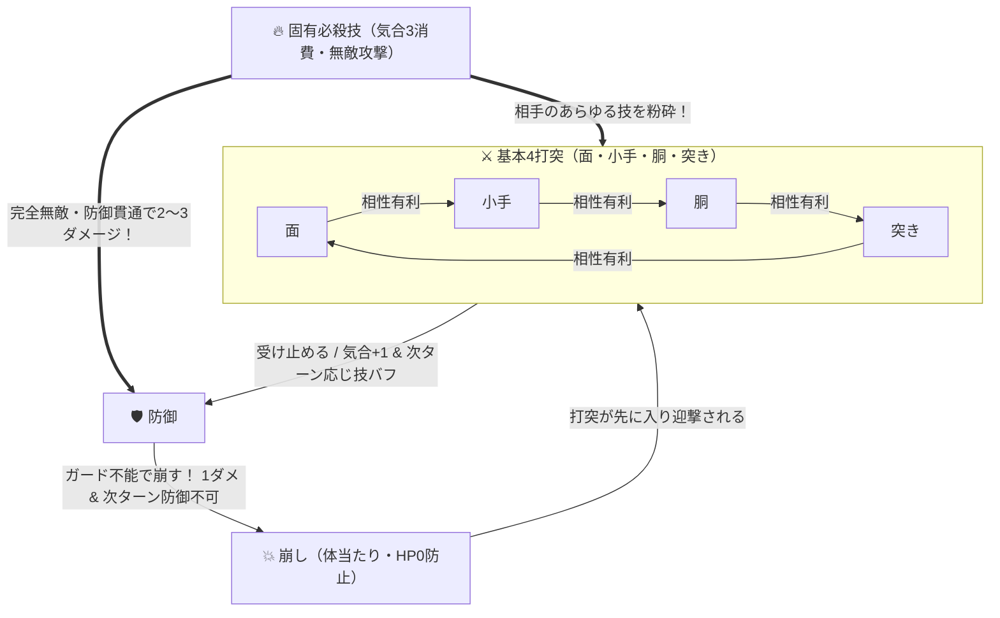

# ⚔️ バトルシステム ＆ 技の駆け引き 詳細ガイド

[⬅️ README（トップ）へ戻る](../README.md) ｜ [🥋 全国制覇モード詳細](club-mode.md) ｜ [🛠️ 技術仕様](technical-spec.md)

---

## 1. バトルシステムの基本原則
本作の試合は、剣道の真髄である「一本勝負の緊張感」と「パラメータ育成が勝敗に直結するダイナミックな駆け引き」を再現したターン制バトルです。  
互いに開始時の体力（HP）を持ち、先に相手の体力を `0` にした側が勝利（一本）となります。

---

## 2. アクション一覧と詳細性能

| コマンド | 消費気合 | 性能と詳細仕様 |
| :--- | :---: | :--- |
| **⚔️ 面** | 0 | 「小手」に相性有利な基本打突。上段の構え時は「上段面」として威力・判定が強化。攻撃命中・相討ち時、および相手に防御された場合でも攻撃側の**気合+1**。 |
| **⚔️ 小手** | 0 | 「胴」に相性有利な基本打突。上段の構えをとる相手に対して特効（ダメージ+1）。攻撃命中・相討ち時、および相手に防御された場合でも攻撃側の**気合+1**。 |
| **⚔️ 胴** | 0 | 「突き」に相性有利な基本打突。下段の構え時は「抜き胴」として迎撃威力が強化。攻撃命中・相討ち時、および相手に防御された場合でも攻撃側の**気合+1**。 |
| **⚡ 突き** | 0 | 「面」に相性有利な基本打突。気合消費なしでいつでも使用可能。上段相手に特効（ダメージ+1）。攻撃命中・相討ち時、および相手に防御された場合でも攻撃側の**気合+1**。 |
| **🛡️ 防御・気合** | 0 | 相手の基本4打突を受け止めて無効化し、**次ターン「🔥 応じ技構え（見切りスタック蓄積）」**になる（**下段の構え中のみ体力+1回復**）。連続で防御を成功させるほど**「見切りLv」が上がり、次回の通常攻撃の成功率（競り合いスコア）が爆発的にUP**（気合ゲージ自体は上がらないため必殺技ループは不可）。中段構え・下段構えの双方で使用可能。**防御成功時は防御側の気合ゲージが不変（+0）、攻撃側に気合+1**。**防御成功時は発声せず完全無言（竹刀で受け止める受音SEのみ再生）**。**お互いに「防御・気合」を選択した場合は、互いに気迫を高め合って双方の気合ゲージが +1 上昇**（双方同時に「ヤァァァ！」を発声）。ただし「崩し」や必殺技には無力（上段の構え中は使用不可）。 |
| **💥 崩し** | 0 | 体当たりで相手のガードを崩す。使用時に**気合+1**。相手の「防御」を突き崩して1〜2ダメージ＋相手の気合0＋相手を次ターン「💫 体勢崩れ（防御不可）」にする。**ガードブレイク成功時に崩し側のみ共通の掛け声「ヤァァァ！」を発声**（迎撃被弾側や崩された側は無言）。相手の基本打突で迎撃被弾した場合は**気合0**。 ※「崩し」ではHP0にならない仕様（相手HPが1のときは「HP1 耐え！」）。相手が気合3（不動心）の時はスタンが無効化されます。 |
| **🔥 固有必殺技** | **3** | 気合ゲージがMAX（3）の時に発動可能。発動時に**気合3を全消費**。技術基準（面/小手/胴/突き）を満たしていれば**完全無敵・防御貫通で2〜3ダメージ**を与える。未覚醒時は「💥 気合一閃（渾身打突）」となる。 |

---

## 3. ⚡ 気合ゲージ増減ルール ＆ 闘気パッシブバフシステム

### 📈 気合ゲージの容量と増減ルール
気合ゲージ（0〜最大8）は試合の呼吸・気迫の流れを現す重要なリソースです。**選手の気力（SPI）ステータスに応じて最大気合値が自動拡張**されます。

- **気力（SPI）に応じた最大気合ゲージ容量**:
  - **気力 50 未満**: 最大気合 **3**（基本性能。健太12、佐々木15、鬼塚18、霞20、龍禅25など通常の高校剣士）
  - **気力 50 〜 59**: 最大気合 **4**
  - **気力 60 〜 69**: 最大気合 **5**
  - **気力 70 〜 79**: 最大気合 **6**
  - **気力 80 〜 89**: 最大気合 **7**
  - **気力 90 以上**: 最大気合 **8**（全国制覇級・不動の極致）

- **必殺技の発動と気合消費**:
  - **発動条件**: **気合 3 以上** でいつでも発動可能（最大値未達であっても即座に使用可能）。
  - **発動後消費**: **気合 0 に全消費リセット**。

- **気合が上昇する条件（+1）**:
  - **お互いに「🛡️ 防御・気合」を使用**: 間合いを測り互いに気勢を充実させ、**双方気合+1**（双方同時に共通掛け声「ヤァァァ！」を発声）。
  - **打突技（面・小手・胴・突き）を使用**: 技が命中・相討ちした時、および**相手に防御された場合でも攻撃側の気合は+1上昇**（攻め続けることで気合が溜まり、防御貫通の必殺技へと繋がる）。
  - **「💥 崩し」を使用**: 体当たりを仕掛けた側に**気合+1**。ただし相手の打突で迎撃被弾した場合は0になります。
  - **同技相討ち・鍔迫り合い突入**: 互いに気迫が激突し、**双方気合+1**。
- **気合が変化しない条件（+0）**:
  - **「🛡️ 防御・気合」成功時（相手の打突を防いだ時）**: 防御に成功した側は**気合不変（+0）**のままHP回復＆見切り蓄積に集中（※攻撃側には気合+1が付与されます）。
- **気合が0にリセットされる条件**:
  - **相手の攻撃が命中した時**: 被弾により気勢が途切れる。
  - **相手の「崩し」を被弾した時**: ガードを割られ体勢を崩される。
  - **「🔥 必殺技」を発動した時**: 気合をすべて放出して会心の一撃を放つ。

### 🌟 気合0〜8段階 闘気パッシブバフ
試合中、気合ゲージ（0〜8）が溜まるにつれて以下のパッシブ効果が自動発動します。必殺技を即座に撃たずに気合を4〜8まで蓄積することで、圧倒的な身体能力とダメージ補正を維持して立ち回る戦術が可能です。

| 気合レベル | 闘気バッジ | 与ダメージ補正 | 被ダメージ軽減 | 会心率 | 競り合い判定補正（技量連動スケーリング） | 特殊効果 |
| :---: | :--- | :---: | :---: | :---: | :---: | :--- |
| **0** | 平常心 | 通常 | 通常 | 0% | 補正なし | なし |
| **1** | ⚡ **気迫充実** | 通常 | 通常 | 18% | **技の +10%**（最低保証 +5） | 会心の一撃解禁 |
| **2** | 🔥 **気位高揚** | **+1** | **-1**（重打突軽減） | 35% | **技の +20%**（最低保証 +10） | |
| **3** | 🌟 **気合最高潮** | **+1** | **-1**（常時軽減） | 60% | **技の +35%**（最低保証 +18） | **不動心**（崩し無効） |
| **4** | 🌌 **明鏡止水** | **+1** | **-1**（常時軽減） | 75% | **技の +42%**（最低保証 +22） | 不動心 |
| **5** | 👑 **天下無双** | **+2** | **-2**（常時軽減） | 85% | **技の +50%**（最低保証 +26） | 不動心（神気オーラ） |
| **6** | ⚡ **剣禅一如** | **+2** | **-2**（常時軽減） | 92% | **技の +58%**（最低保証 +30） | 不動心（神気オーラ） |
| **7** | 🐉 **神気覚醒** | **+2** | **-2**（常時軽減） | 96% | **技の +66%**（最低保証 +35） | 不動心（神気オーラ） |
| **8** | 🌌✨ **極致・剣神不動** | **+3** | **-3**（常時軽減） | **99%** | **技の +75%**（最低保証 +40） | 不動心（神気オーラ） |

---

## 4. 🥋 技パラメータ対決＆有効打突判定モデル

両者が打突技を選択した場合、固定ジャンケンではなく以下の技量連動スコアモデルで競り合いを判定します：

$$\text{判定スコア} = \text{技パラメータ} + \text{理合相性ボーナス} + \text{気合ボーナス} + \text{基礎能力ボーナス(腕力/敏捷/気力)} + \text{構え/応じ技ボーナス}$$

- **技量連動スケーリング**: 技を鍛えるほど相性有利や気合の加算値も自動的にスケールアップするため、パラメータ育成の価値が常に主役であり続けます。
- **格上への逆転**: 技術差15程度であれば相性有利（+30%）で互角以上に競り勝ち、技術差25の大将クラスであっても「相性有利＋気位高揚（気合2）」の組み合わせで劇的な逆転一本が奪えます。
- **技術未熟ペナルティ（技パラメータ20以下）**: 競り勝っても「打突が浅く有効打突にならない（ダメージ0）」が低確率で発生（敏捷が高いと足捌きにより不発リスクが低減）。
- **⚔️ 競り合いクラッシュメーターの可視化**:
  - 打突の激突時には画面中央（体力ゲージ・パラメータを隠さないスプライト交錯位置）にクラッシュメーターが展開されます。
  - 勝敗要因バッジは**「左列：自身（赤）」「右列：敵側（青）」の左右2列構成**で表示され、相性有利、技術優位、剛腕、見切り、気合闘気、気力充実など、双方が何の要素で優位に立っているかが一目で直感的に分かります。
  - **画面上のどこをクリックしても即座にメーターを閉じることができます**（次のアクション選択もスムーズに行えます）。

---

## 5. 💪 基礎能力の役割分担（腕力＝攻撃系、敏捷＝防御系、気力＝精神系）

部活育成や基本能力値（腕力・敏捷・気力）は、剣道の理合に基づいて試合中の攻防に明確に反映されます。

### ① 💪 腕力（STR: 攻撃系）
- **打突の重み（競り合いスコア加算）**: 基本4打突の競り合いスコアに `Math.round(STR × 0.22)` を直接加算（例: STR 30で +7）。クラッシュメーターに `💪 剛腕押し切り` として表示。
- **剛腕会心ダメージ（重打突）**: 自身の腕力が相手の腕力を上回っている場合（`STR > eSTR`）、腕力差に応じた確率（**差 × 1%、最大40%**）で **ダメージ +1（会心の一撃）** が発動（ポップアップ: `💥 剛腕会心！`）。
- **「崩し」の威力強化**: 相手との腕力差が `+4` 以上ある場合、崩し成功時のダメージが `1 → 2` に強化。

### ② ⚡ 敏捷（AGI: 防御系）
- **紙一重の体捌き（被ダメージ軽減）**: 相手から打突を受けた際、自身の敏捷が相手の敏捷を上回っている場合（`AGI > eAGI`）、敏捷差に応じた確率（**差 × 1%、最大40%**）で **被ダメージを -1 軽減**（芯を外して受ける）。ポップアップに `⚡ 紙一重の体捌き！ (-1軽減)` と表示。1ダメージの攻撃に対して発動した場合は被ダメージ0（有効打突不発）となります。
- **見切り応じ技の大幅強化**: 「防御」成功後の次ターンの応じ技競り合いスコアに、敏捷ボーナス `+ Math.round(AGI × 0.35)` を加算（例: AGI 30で +11）。クラッシュメーターに `⚡ 見切り応じ技` として表示。
- **崩し迎撃時の被ダメ軽減**: 自身が「崩し」を使用して相手の基本打突で迎撃された際、腕力または敏捷が相手を上回っていれば、**腕力差または敏捷差の大きい値に応じた確率（最大差 × 1%、上限40%）で被ダメージを -1 軽減**（`💪 剛腕受け！` または `⚡ 身のこなし！`）。
- **技の不発リスク低減**: 技術未熟（技 < 20）時の打突浅し（不発率）を、正確な足捌きで低減。

### ③ 🔥 気力（SPI: 精神・気合系）
- **気合ゲージ最大値拡張**: 気力ステータスに応じて気合ゲージの最大容量が拡張（気力50未満:3、50代:4、60代:5、70代:6、80代:7、90以上:8）。
- **不動心（スタン耐性）**: 気力14以上で、相手の「崩し」による体勢崩壊・スタンを確率で踏みとどまり無効化。
- **気迫の底上げ**: 気力14以上で、競り合いスコアに気迫ボーナス `Math.round((SPI - 10) × 0.25)` を加算。
- **気合充填ボーナス**: 気力14以上で、気合ゲージ上昇時（打突・崩し・防御気合など）に確率で追加気合+1ボーナスが発動。
- **気合充填・起死回生**: 精神の充実により気合闘気バフの恩恵を最大化。

---

## 6. 🔥 個人固有の得意技（必殺技）一覧と解放条件

| 技名 | 系統 | 必要技術 | 威力 | 技の特徴 |
| :--- | :---: | :---: | :---: | :--- |
| **飛燕二段面** | 面 | 面 38 | 2 | 電光石火の二段面。相手のあらゆる守りを頭上から粉砕する。 |
| **剛烈・兜割り** | 面 | 面 52 | 2 | 豪腕を叩き込む重烈な面。相手の太刀筋を力で押し潰す。 |
| **天光一刀面** | 面 | 面 65 | 3 | 天頂より振り下ろす極光の一閃。相討ちを許さぬ究極の面。 |
| **出ばな電撃小手** | 小手 | 小手 40 | 2 | 技の起こりを捉える神速の小手。手元を閃光のように射抜く。 |
| **霞打ち連撃小手** | 小手 | 小手 55 | 2 | 残像を残す幻惑の小手。相手の防御の隙間に吸い込まれる。 |
| **疾風抜き胴** | 胴 | 胴 40 | 2 | 相手の打突を紙一重でかわし、瞬時に脇腹を斬り抜く。 |
| **幻影逆胴一閃** | 胴 | 胴 55 | 2 | 死角から切り返す幻の逆胴。相手の反撃の機先を完全に制す。 |
| **紫電一閃突き** | 突き | 突き 38 | 2 | 喉元へ直線一筋に放たれる神速の突き。相手の構えを貫通する。 |
| **天翔諸手突き** | 突き | 突き 60 | 3 | 全身の体重と気迫を竹刀の先一点に乗せて穿つ奥義。 |

---

## 7. 状態バッジと戦闘状況

- **💥 鍔迫り合い（引き技モード）**：同技の相打ち（面vs面・小手vs小手・胴vs胴）や「崩し vs 崩し」で突入。専用の前傾押し合いポーズになり、打突がバックステップ斬撃「引き面・引き小手・引き胴（2ダメージ）」、突きが「離れ突き（3ダメージ）」へ変化。
- **🔥 応じ技構え（見切りスタック・次打2倍＆成功率大幅UP）**：防御成功の次ターンに付与。打突がヒットすると **2ダメージ** になり、さらに防御を連続成功させるほど「見切りLv」が上昇して競り合いスコア（攻撃成功率）が特大強化されます：
  - **見切りLv1（防御1回成功）**: 基礎補正 **+18** ＆ 敏捷 **×0.35**（打突2ダメージ）
  - **見切りLv2（防御2連続成功）**: 基礎補正 **+32** ＆ 敏捷 **×0.55**（打突2ダメージ）
  - **見切りLv3（防御3連続成功・極致）**: 基礎補正 **+48** ＆ 敏捷 **×0.80**（打突2ダメージ、相性不利を軽々粉砕）
  ※見切りボーナスは**次回の攻撃1回限りの使い切り**です。打突を繰り出すと消費されてLv0に戻ります。相手の「崩し」や被弾によっても解除されます。防御成功で気合は増えないため、「防御だけで必殺技を溜める」ことはできず、自ら打突を打ち込む必要があります。
- **💫 体勢崩れ（防御不可）**：防御中に相手の「崩し」を受けた次ターンに付与。1ターンの間「防御」が選択できなくなります。
- **⚡ 気合最高潮（突き可）**：気合ゲージが3溜まり、必殺技「突き」が発動可能な状態です。

---

## 8. 特殊ルールと駆け引き

### ① 被弾・崩し成功時の気合リセット
相手からの打突（面・小手・胴・突き）または「崩し」を被弾した側は、**蓄積していた気合ゲージが0にリセット**されます。必殺技「突き」を狙う際は、相手の攻めを凌ぎ切る間合いの管理が極めて重要になります。

### ② 「崩し」のHP最低1保証
剣道の崩し（体当たり）は相手の防御をこじ開ける戦術技であり、決め技ではないため、**「崩し」でHPを0にすることはできません**。相手の体力が1のときに崩しを成功させても「HP1 耐え！」となり、次ターンの打突（一本）で仕留める緊迫感のある攻防が生まれます。

---

## 9. 🎋 3つの構え（リアルタイム切替システム）
コマンド上部の構えバーから、**ターン消費なし**でいつでも構えを切り替えられます。剣道の五行の理合に基づき、3つの構えそれぞれに強烈な個性と使い分けの戦術的意味が存在します。

| 構え | コンセプト | 主な特徴とメリット | デメリット・弱点 | 推奨シチュエーション |
| :--- | :--- | :--- | :--- | :--- |
| **⚖️ 中段の構え**（水） | **正統派・隙なし** （万能・必殺特化） | ・全技（面・小手・胴・突き）の競り合い判定値 **+3** ・全アクションで確実に**気合+1**（**最速で必殺技にアクセス可能**） ・相手の上段に対して安定して「小手」「突き」特効を刺せる ・「防御」で打突を完全に防ぎ見切りLvを獲得 | ・一撃2ダメージのような突発的破壊力はない ・防御時のHP回復はなし（HP回復は下段の特権） | 立ち合いの基本、相手の手の内を観察する時、上段の相手を迎撃する時、気合3を溜めて必殺技で決めたい時 |
| **🔥 上段の構え**（火） | **豪快な強襲** （攻撃特化） | ・「面（上段面）」のダメージ **+1（通常2ダメ、応じ時3ダメ）** ・「面」の競り合い判定値 **+6** ・相面（面vs面）を一方的に粉砕制覇 | ・**「防御」が一切使用不可**。 ・「小手」「突き」被弾時のダメージが **+1** 増加。 | 相手の残HPが1〜2で一気に削り切りたい時、相面でねじ伏せたい時 |
| **🌊 下段の構え**（地） | **防壁と迎撃** （防御・回復特化） | ・**「防御（後の先防御）」成功時にHP+1回復（下段限定の特権！）** ・**「抜き胴（2ダメージ）」の発動**： 　①相手の「崩し」を迎撃した時 　②**相手の「面」に対して「胴」で競り勝った時** ・「胴」の競り合い判定値 **+4** | ・剣先が低いため「面」「突き」の判定値 **-3** ・「面」を打っても気合増加なし（+0） | **体力が減って回復したい時**、相手が「面」や「崩し」を多用してくる時のカウンター狙い |

---

## 10. 🧠 ワンパターン対策・適応型AI学習 ＆ 見切り警戒知性システム
本作の敵AIは、単なるランダム選択ではなく、**プレイヤーの直近の行動履歴および見切り・気合状態を常に分析して最適な手を打つ高度な知性**を備えています。

- **見切り警戒（Counter Alert）AI**:
  - プレイヤーが防御を成功させ「見切り構え（次打の威力2倍）」となった際、敵AIは**「次は強烈な打突が飛んでくる」と察知**します。
  - 通常攻撃に一方的に負けてカウンター迎撃を受ける**「崩し」の無謀な選択を完全封印（0%）**。
  - 代わりに**「敵も防御してプレイヤーの見切りスタックを浪費させる（＝敵が見切りを奪い返す）」**か、**「プレイヤーの構えや傾向を読んで相性勝ちの打突を合わせる」**行動を選択し、互いに見切りを読み合う本格的な真剣勝負が展開されます。
- **ワンパターンの学習検知**:
  - 「守り癖（見切りがあるのに攻撃せず、連続して防御を重ねる）」$\rightarrow$ 守りに入った隙を突いて**「崩し」**でガードブレイク。
  - 「面の連打」$\rightarrow$ **下段「抜き胴」**で迎撃。
  - 「小手の連打」$\rightarrow$ **「相面」**で上から乗り切る。
  - 「胴の連打」$\rightarrow$ **出端「小手」**で断つ。
  - 「気合MAX時の突き狙い」$\rightarrow$ 鋭い突きや小手で先手を取る。
- **5人の剣士ごとの個性と知性スケーリング**:
  - **健太（初段）**: 初心者らしく、たまに焦って崩しを暴発する隙が残る。
  - **佐々木（三段）**: 相手の見切りに対して「下段（後の先防御）」で受け流しを狙う。
  - **鬼塚（四段）**: 相手の見切りに臆さず「上段面」で剛腕勝負を挑む。
  - **霞（五段）**: 高い敏捷で「抜き胴」または冷静な「防御」でカウンターを無効化。
  - **龍禅（八段）**: 崩しの暴発ゼロ。完璧な防御で見切りを枯らすか、理合を完全封殺する打突を放つ最高峰の知性。
- **手の内を明かさないリアルな駆け引き**:
  - 画面上に露骨な「見切った！」などの予告は一切表示されず、自然な構えの気配の中から突如として裏をかく技が飛んでくるため、常に相手の思考を警戒する本物の真剣勝負が展開されます。

---

## 11. 🗣️ 発声ルール（攻撃成功時の技名発声 ＆ 掛け声「ヤァァァ！」の条件限定）
本作では立ち合いの迫力と明快さを追求し、**「攻撃成功側（技名）または崩し成功・双方気合（ヤァァァ！）のみが発声する（被弾側・防御成功側は無言）」**ルールに統一されています。

| 状況 | 判定結果 | 発声する側 | 発声内容 | 備考 |
| :--- | :--- | :---: | :--- | :--- |
| **🛡️ 防御成功** | 相手の基本打突を防いだ | **双方無言（発声なし）** | — | **竹刀で受け止める受音SEのみ** 🔇 |
| **⚔️ 攻撃（打突・必殺）成功** | 相手に技が命中 | **攻撃成功側のみ** | **技名**（「めーん！」「こてー！」「どうー！」「つきー！」） | **攻撃された側は完全無言** ✅ |
| **💥 崩し成功** | 相手の防御を破った | **崩し成功側のみ** | **掛け声「ヤァァァ！」** | 崩された側は完全無言 ✅ |
| **💥 崩し追撃成功** | 体勢崩れ中の相手に崩し命中 | **崩し成功側のみ** | **掛け声「ヤァァァ！」** | 被弾側は完全無言 ✅ |
| **⚔️ 崩し迎撃成功** | 相手の崩しを打突で迎撃命中 | **打突迎撃側のみ** | **技名**（「めーん！」等） | 迎撃された崩し側は完全無言 ✅ |
| **🔥 双方「防御・気合」** | 互いに間合いを測り気勢激突 | **双方同時** | **掛け声「ヤァァァ！」** | 互いに成功のため両者発声 ✅ |
| **💥 相討ち（双方が被弾）** | 互いに打突を受け被弾 | **双方無言（発声なし）** | — | **双方が攻撃された側のため完全沈黙** ❌ |
| **鍔迫り合い突入 / 打突浅し** | 激突・技量不足・紙一重 | **双方無言（発声なし）** | — | 打突SEのみ ❌ |

- **防御成功時・攻撃された側・失敗側は完全無言**: 防御成功時は声を出さず受音SEのみが響き、技を防がれた側や崩された側、打突を被弾した側（相討ち含む）も一切声を発しません。
- **掛け声の共通化**: 全剣士共通で「ヤァァァ！」（音声合成テキスト:「やぁぁぁ！」）に統一。崩し成功時および双方防御・気合時のインパクト到達時（380ms）にSEと完全シンクロして発声されます。

---

## 7. 🏆 勝ち抜き五人掛けモード（免許皆伝・五人掛けの試練）
道場の最高位である「免許皆伝」を懸け、同門・先輩・師範代の精鋭5人と連戦を行うアーケードモードです。
テンポを阻害しない軽快な会話ダイアログ（Space/Enterまたは画面タップで送れ、スキップ可能）に加え、**各試練の専用イラスト（全6点）**により、一戦ごとのドラマと剣の理念（交剣知愛）を視覚的にも体感できます。

1. **第一の試練：先鋒・門下生・健太（初段）** — 【無垢なる熱意】（`img/story/trial1_kenta.png`）
   - 剣風：素直な面打ち（中段・上段）
   - テーマ：初心忘るるべからず。恐れを知らぬ真っ直ぐな飛び込み面でプレイヤーの覚悟を試す。
2. **第二の試練：次鋒・小手名人・佐々木（三段）** — 【静寂の見切り】（`img/story/trial2_sasaki.png`）
   - 剣風：出ばな小手と下段の構えの受け（中段・下段）
   - テーマ：後の先と観察の理。僅かな手元の隙を容赦なく断つ技巧派の壁。
3. **第三の試練：中堅・剛剣・鬼塚（四段）** — 【剛毅なる気魄】（`img/story/trial3_onizuka.png`）
   - 剣風：剛剣上段と豪快な崩し（中段・上段）
   - テーマ：剛毅木訥と気迫の激突。火の上段と怒涛の体当たり崩しで胆力を試す。
4. **第四の試練：副将・幻影・霞（五段）** — 【鏡花水月の惑い】（`img/story/trial4_kasumi.png`）
   - 剣風：三構え変化と応じ技（中段・上段・下段）
   - テーマ：虚実と心の静寂。相手の焦りや執着を映し出す変幻自在の心理戦。
5. **最終試練：大将・師範代・龍禅（範士八段）** — 【不動心の極致】（`img/story/trial5_ryuzen.png`）
   - 剣風：天地水の三位一体・諸手突き（全構え）
   - テーマ：師を超える一撃。全構えと究極の知性を操る道場の絶対王者。

### 📜 免許皆伝エピローグ演出（`img/story/menkyo_kaiden.png`）
大将・龍禅を破ると、専用BGM（『Gold in the Dojo』）と共に授与式イラストと「免許皆伝之証」モーダルが表示されます。
- 授与式の感動的なエピローグ記念イラスト
- 龍禅からの免許皆伝の祝辞
- 健太・佐々木・鬼塚・霞の4人による祝福の寄せ書きコメントカード
- 勝ち抜き総ターン数・決まり手などの試練達成戦績を表示

---

## 8. 🙇 剣道礼法・所作の美
「礼に始まり礼に終わる」武士道精神を忠実に再現：
- **試合前**：提げ刀（さげとう）での対峙
- **立礼・帯刀・抜刀 ➔ 蹲踞（そんきょ）**
- **審判の「🚩 始め！」で立ち上がり試合開始**
- **勝敗決定後 ➔ 蹲踞 ➔ 納刀（のうとう） ➔ 立礼**

---

[⬅️ README（トップ）へ戻る](../README.md) ｜ [🥋 全国制覇モード詳細](club-mode.md) ｜ [🛠️ 技術仕様](technical-spec.md)

