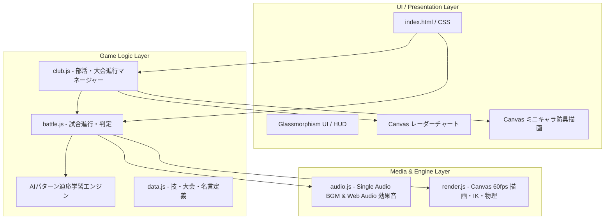
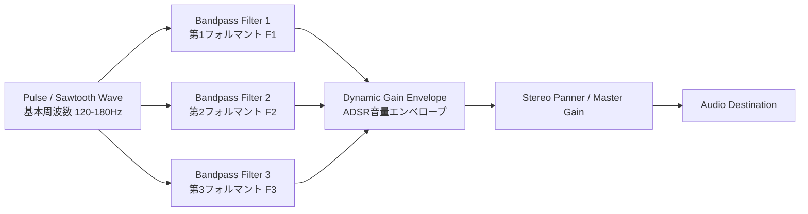

# 🛠️ 技術仕様・アーキテクチャ詳細 (Technical Specifications)

[⬅️ README（トップ）へ戻る](../README.md) | [🥋 全国制覇モード](club-mode.md) | [⚔️ 一本勝負バトルシステム](battle-system.md)

---

本書では、『高校剣道 激闘の軌跡 - 一本勝負 -』を支えるフロントエンド技術、音響合成システム、リアルタイム描画エンジン、およびUI/UX設計について解説します。

---

## 目次
- [1. システム全体構成](#1-システム全体構成)
- [2. Web Audio API 音響・プロシージャル音声合成システム](#2-web-audio-api-音響プロシージャル音声合成システム)
  - [2.1 Single Audio Player パターンによるBGM制御](#21-single-audio-player-パターンによるbgm制御)
  - [2.2 プロシージャル審判号令合成（ハジメ！・ヤメ！・一本！）](#22-プロシージャル審判号令合成ハジメヤメ一本)
  - [2.3 竹刀打撃音・鍔迫り合い・和太鼓打音合成](#23-竹刀打撃音鍔迫り合い和太鼓打音合成)
- [3. HTML5 Canvas 60fps リアルタイム描画エンジン](#3-html5-canvas-60fps-リアルタイム描画エンジン)
  - [3.1 64コマ超解像スプライト＆2ボーンIKアニメーション](#31-64コマ超解像スプライト2ボーンikアニメーション)
  - [3.2 袴・道着のクロス（布）シミュレーション](#32-袴道着のクロス布シミュレーション)
  - [3.3 鍔迫り合いの火花・衝撃波・オーラパーティクル](#33-鍔迫り合いの火花衝撃波オーラパーティクル)
- [4. UI/UX設計とレスポンシブ対応](#4-uiux設計とレスポンシブ対応)
  - [4.1 Glassmorphism（透過すりガラス）デザイン](#41-glassmorphism透過すりガラスデザイン)
  - [4.2 モバイル・Safe Area最適化](#42-モバイルsafe-area最適化)
- [5. 関連ドキュメント・リンク](#5-関連ドキュメントリンク)

---

## 1. システム全体構成

本ゲームは外部ライブラリ（React, Vue, Phaser等）に一切依存せず、**Pure Vanilla JavaScript (ES6+), HTML5 Canvas, Web Audio API** のみで構築されたゼロ・ディペンデンシーのハイパフォーマンスWebアプリケーションです。



---

## 2. Web Audio API 音響・プロシージャル音声合成システム

### 2.1 Single Audio Player パターンによるBGM制御
モバイルブラウザ（iOS Safari / Android Chrome）におけるオーディオ自動再生制限（Autoplay Policy）を完全クリアするため、単一の `HTMLAudioElement` インスタンスを使い回す **Single Audio Player パターン** を採用しています。

- **シームレスなクロスフェード**:
  シーン遷移（タイトル ➔ 部室 ➔ 大会 ➔ 試合中 ➔ 勝利/敗北）時に、音量をミリ秒単位でイージングしながら次トラックへスムーズに移行。
- **永続化**:
  BGM/SEのミュート状態および音量設定は `localStorage` に即時保存され、次回起動時にも引き継がれます。

### 2.2 プロシージャル審判号令合成（ハジメ！・ヤメ！・一本！）
外部の巨大な音声ファイルをロードすることなく、ブラウザ内蔵の **Web Audio API** のみで人間の審判の発声を合成（プロシージャル音声合成）しています。



- **母音フォルマント周波数合成**:
  日本語の「ア」「イ」「オ」「エ」に対応する固有のフォルマント共鳴周波数（F1, F2, F3）を、複数の `BiquadFilterNode` で並列にフィルタリング。
- **気迫のピッチベンド**:
  「ハ・ジ・メェ！」の語尾にかけて周波数を持ち上げ、腹底から響く鋭い審判の気迫を再現。

### 2.3 竹刀打撃音・鍔迫り合い・和太鼓打音合成
- **竹刀の鋭い打突音**:
  ホワイトノイズバーストに急峻なハイパスフィルターをかけ、瞬間的なディケイで竹のしなりと乾いた破裂音を再現。
- **鍔迫り合い（ツバゼリ）の軋み音**:
  金属・樹脂が擦れ合う高周波倍音とランダムな微小クリック音を連続発振。
- **開会式・一本決着時の和太鼓「ドン！」**:
  サイン波の急激なピッチエンベロープ下降（80Hz ➔ 30Hz）に低域ブーストとノイズの打撃成分をブレンドし、重厚な空気の振動を表現。

---

## 3. HTML5 Canvas 60fps リアルタイム描画エンジン

### 3.1 64コマ超解像スプライト＆2ボーンIKアニメーション
剣士の挙動（中段構え、面打ちの振り上げ・踏み込み・残心）は、**2ボーン・インバースキネマティクス（IK）** と物理演算によって滑らかに制御されています。

- **打突の踏み込み速度感**:
  打突発生瞬間にキャラクター全体の水平座標を急加速させ、Canvas の motion blur 風の残像シャドウを生成。
- **竹刀のしなり（Bending）**:
  打突が相手の面に命中した瞬間、竹刀の先端座標を一時的に遅延させ、打突の衝撃による竹刀の湾曲をベジェ曲線でリアルタイム描画。

### 3.2 袴・道着のクロス（布）シミュレーション
剣士の激しい前後ステップや踏み込みに合わせて、袴（はかま）の裾野と道着の揺れをバネ・ダンパーモデル（Verlet Integration）で近似計算。重厚感のある藍染め武州正藍染の風合いをアニメーションで表現しています。

### 3.3 鍔迫り合いの火花・衝撃波・オーラパーティクル
- **衝突パーティクル**:
  竹刀同士が激突した接点から、物理反射角に基づいた火花パーティクルを放射状に放出。
- **気合オーラ**:
  気合ゲージの充填率に応じて、足元から立ち昇る気流パーティクルと輪郭グロー効果を動的にブレンド描画。

---

## 4. UI/UX設計とレスポンシブ対応

### 4.1 Glassmorphism（透過すりガラス）デザイン
UIは和風の伝統美と現代的なサイバー・フラットデザインを融合させた **Glassmorphism** を採用。

```css
/* すりガラス風パネルの共通スタイル */
.glass-panel {
  background: rgba(10, 20, 35, 0.75);
  backdrop-filter: blur(12px);
  -webkit-backdrop-filter: blur(12px);
  border: 1px solid rgba(255, 255, 255, 0.12);
  box-shadow: 0 8px 32px 0 rgba(0, 0, 0, 0.37);
  border-radius: 12px;
}
```

### 4.2 モバイル・Safe Area最適化
スマートフォン（iPhone / Android）での横画面・縦画面プレイに対応。

- **Safe Center レイアウト**:
  スマートフォンのノッチやホームインジケーター（Safe Area Insets）を考慮し、試合画面のCanvas描画領域を `safe-area-inset-*` 内側にセンタリング配置。
- **Android 固定ボトムバー配慮**:
  下部ナビゲーションやジェスチャーバーと操作ボタンが重ならないよう、余白とタップターゲット（最小48px）を厳密に確保。
- **タッチレスポンス改善**:
  `touch-action: manipulation;` によるダブルタップズーム防止と、ポインターイベントのゼロレイテンシ化を実施。

---

## 5. 関連ドキュメント・リンク

- [⬅️ README（トップ）へ戻る](../README.md)
- [🥋 全国制覇モード ドキュメント](club-mode.md)
- [⚔️ 一本勝負バトルシステム ドキュメント](battle-system.md)
- [🎮 ブラウザで今すぐプレイ（GitHub Pages）](https://ykobayash.github.io/Kendo/)

