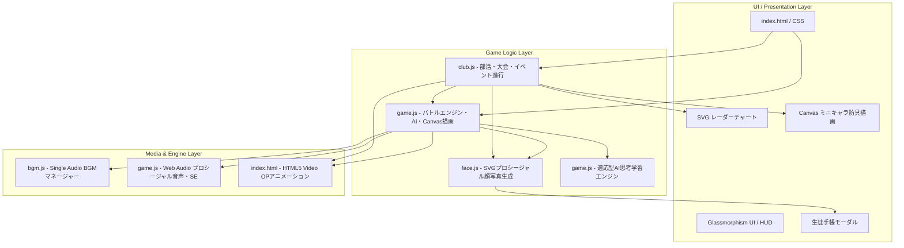
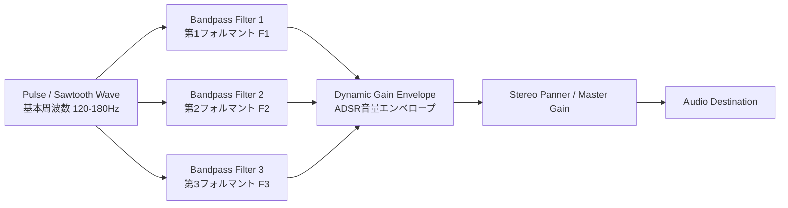

# 🛠️ 技術仕様・アーキテクチャ詳細 (Technical Specifications)

[⬅️ README（トップ）へ戻る](../README.md) | [🥋 全国制覇モード](club-mode.md) | [⚔️ 一本勝負バトルシステム](battle-system.md)

---

本書では、『高校剣道 激闘の軌跡 - 一本勝負 -』を支えるフロントエンド技術、音響合成システム、リアルタイム描画エンジン、SVGプロシージャル生成、およびUI/UX設計について解説します。

---

## 目次
- [1. システム全体構成](#1-システム全体構成)
- [2. SVG プロシージャル顔写真生成エンジン（FaceGenerator）](#2-svg-プロシージャル顔写真生成エンジンfacegenerator)
  - [2.1 シード値決定論的アルゴリズム](#21-シード値決定論的アルゴリズム)
  - [2.2 レイヤー構成と幾何学パーツ生成](#22-レイヤー構成と幾何学パーツ生成)
  - [2.3 生徒手帳モーダルUIとDOM描画](#23-生徒手帳モーダルuiとdom描画)
- [3. HTML5 Video API によるオープニングムービー制御](#3-html5-video-api-によるオープニングムービー制御)
  - [3.1 両ゲームモードへの専用OPアニメーション配備](#31-両ゲームモードへの専用opアニメーション配備)
  - [3.2 インライン再生・音声切替・シームレススキップ](#32-インライン再生音声切替シームレススキップ)
- [4. Web Audio API 音響・プロシージャル音声合成システム](#4-web-audio-api-音響プロシージャル音声合成システム)
  - [4.1 Single Audio Player パターンによるBGM制御](#41-single-audio-player-パターンによるbgm制御)
  - [4.2 プロシージャル審判号令合成（ハジメ！・ヤメ！・一本！）](#42-プロシージャル審判号令合成ハジメヤメ一本)
  - [4.3 竹刀打撃音・鍔迫り合い・和太鼓打音合成](#43-竹刀打撃音鍔迫り合い和太鼓打音合成)
  - [4.4 厳格な剣道作法に基づくリアルタイム発声制御](#44-厳格な剣道作法に基づくリアルタイム発声制御)
- [5. HTML5 Canvas 60fps リアルタイム描画エンジン](#5-html5-canvas-60fps-リアルタイム描画エンジン)
  - [5.1 64コマ超解像スプライト＆2ボーンIKアニメーション](#51-64コマ超解像スプライト2ボーンikアニメーション)
  - [5.2 袴・道着のクロス（布）シミュレーション](#52-袴道着のクロス布シミュレーション)
  - [5.3 鍔迫り合いの火花・衝撃波・オーラパーティクル](#53-鍔迫り合いの火花衝撃波オーラパーティクル)
- [6. UI/UX設計とレスポンシブ対応](#6-uiux設計とレスポンシブ対応)
  - [6.1 Glassmorphism（透過すりガラス）デザイン](#61-glassmorphism透過すりガラスデザイン)
  - [6.2 モバイル・Safe Area最適化](#62-モバイルsafe-area最適化)
  - [6.3 保留バナー進行システム](#63-保留バナー進行システム)
- [7. 関連ドキュメント・リンク](#7-関連ドキュメントリンク)

---

## 1. システム全体構成

本ゲームは外部フレームワーク（React, Vue, Phaser等）や外部CSSライブラリに一切依存せず、**Pure Vanilla JavaScript (ES6+), SVG, HTML5 Canvas, Web Audio API, HTML5 Video API** のみで構築されたゼロ・ディペンデンシーのハイパフォーマンスWebアプリケーションです。



---

## 2. SVG プロシージャル顔写真生成エンジン（FaceGenerator）

外部画像ファイル（PNG/JPG）を大量に保持・通信することなく、コードのみで無数の高校生剣士の証明写真アバターを描画する専用エンジン（`js/face.js`）を開発・搭載しています。

### 2.1 シード値決定論的アルゴリズム
部員や対戦相手の氏名・ID・シード値をハッシュ化（擬似乱数生成器 `createRng`）し、同一キャラクターであれば常に同一の顔グラフィックが決定論的に再現されます。

### 2.2 レイヤー構成と幾何学パーツ生成
SVGベクターグラフィックス（160×200px基準）の多重レイヤー構造で描画されます：
1. **背景レイヤー**: ブルーバック証明写真グラデーション（`#3b82f6` ➔ `#1e3a8a`）
2. **体・制服レイヤー**: 学ラン（詰襟・金ボタン）、ブレザー（ネクタイ付）、白道着・紺道着
3. **首・輪郭・肌レイヤー**: 肌色5種（色白、標準、健康的、日焼け、剣道焼け）とシャドウ・チーク
4. **耳・目・眉・鼻・口レイヤー**: 凛々しい太眉、鋭い目、穏やかな目、二重まぶた、ハイライト
5. **髪型・髪色レイヤー**: スポーツ刈り、ショート、センター分け、癖毛など多彩な髪型とハイライト
6. **表情・装飾レイヤー**: 闘志の傷、絆創膏、眼鏡、汗など

### 2.3 生徒手帳モーダルUIとDOM描画
部員カードや試合中の選手枠をクリックすると、本物の高校生徒手帳を模した革手帳風モーダルが滑らかにオーバーレイ表示されます。SVG顔写真、学校印、学年、ポジション、得意技、8軸パラメータ、パーソナリティがリアルタイムにバインドされます。

---

## 3. HTML5 Video API によるオープニングムービー制御

### 3.1 両ゲームモードへの専用OPアニメーション配備
- **全国制覇モード**: `img/story/prologue_revival_anime.mp4`（埃をかぶった道場の南京錠を外し再興する創部ストーリー）
- **勝ち抜き五人掛けモード**: `img/story/trial_op_anime.mp4`（龍神館道場の厳かな門をくぐり試練に挑むストーリー）

### 3.2 インライン再生・音声切替・シームレススキップ
- モバイルブラウザでの全画面強制表示を回避するため、`playsinline` 属性を付与。
- 音声ON/OFF切り替えボタンおよび、いつでも一瞬でゲーム本編へ進めるスキップボタンを実装。
- 再生終了またはスキップ時に自動でBGMの再生へとシームレスにハンドオフされます。

---

## 4. Web Audio API 音響・プロシージャル音声合成システム

### 4.1 Single Audio Player パターンによるBGM制御
モバイルブラウザ（iOS Safari / Android Chrome）におけるオーディオ自動再生制限（Autoplay Policy）を完全クリアするため、単一の `HTMLAudioElement` インスタンスを使い回す **Single Audio Player パターン** を採用しています。
- シーン遷移（タイトル ➔ 部室 ➔ 大会 ➔ 試合中 ➔ 授与式・表彰式）時に、ミリ秒単位のイージングで次トラックへ滑らかにクロスフェード。
- BGMの再生状態や音量は `localStorage` に即時永続化。

### 4.2 プロシージャル審判号令合成（ハジメ！・ヤメ！・一本！）
外部の巨大な音声ファイルをロードすることなく、ブラウザ内蔵の **Web Audio API** のみで人間の審判の発声を合成（フォルマント合成）しています。



- **母音フォルマント周波数合成**:
  日本語の「ア」「イ」「オ」「エ」に対応する固有のフォルマント共鳴周波数（F1, F2, F3）を、複数の `BiquadFilterNode` で並列にフィルタリング。
- **気迫のピッチベンド**:
  「ハ・ジ・メェ！」の語尾にかけて周波数を持ち上げ、腹底から響く鋭い審判の気迫を再現。

### 4.3 竹刀打撃音・鍔迫り合い・和太鼓打音合成
- **竹刀の鋭い打突音**:
  ホワイトノイズバーストに急峻なハイパスフィルターをかけ、瞬間的なディケイで竹のしなりと乾いた破裂音を再現。
- **鍔迫り合い（ツバゼリ）の軋み音**:
  金属・樹脂が擦れ合う高周波倍音とランダムな微小クリック音を連続発振。
- **開会式・一本決着時の和太鼓「ドン！」**:
  サイン波の急激なピッチエンベロープ下降（80Hz ➔ 30Hz）に低域ブーストとノイズの打撃成分をブレンドし、重厚な空気の振動を表現。

### 4.4 厳格な剣道作法に基づくリアルタイム発声制御
立ち合いの臨場感と剣道の礼節を忠実に守るため、以下の厳格な条件制御を行っています：
- **攻撃成功側のみ発声**: 技が命中した剣士のみが技名（「めーん！」「こてー！」等）を発声。
- **防御成功時・攻撃被弾側・失敗側は完全無言**: 竹刀の受音SEのみが響き、声を発しません。
- **掛け声の共通化**: 崩し成功時および双方防御・気合時のみ、掛け声「ヤァァァ！」を打突SEと380msで完全シンクロ発声。
- **相討ち時の沈黙**: 双方が被弾側となるため完全沈黙。

---

## 5. HTML5 Canvas 60fps リアルタイム描画エンジン

### 5.1 64コマ超解像スプライト＆2ボーンIKアニメーション
剣士の挙動（中段構え、面打ちの振り上げ・踏み込み・残心）は、**2ボーン・インバースキネマティクス（IK）** と物理演算によって滑らかに制御されています。
- **打突の踏み込み速度感**:
  打突発生瞬間にキャラクター全体の水平座標を急加速させ、Canvas の motion blur 風の残像シャドウを生成。
- **竹刀のしなり（Bending）**:
  打突が相手の面に命中した瞬間、竹刀の先端座標を一時的に遅延させ、打突の衝撃による竹刀の湾曲をベジェ曲線でリアルタイム描画。

### 5.2 袴・道着のクロス（布）シミュレーション
剣士の激しい前後ステップや踏み込みに合わせて、袴（はかま）の裾野と道着の揺れをバネ・ダンパーモデル（Verlet Integration）で近似計算。重厚感のある藍染め武州正藍染の風合いをアニメーションで表現しています。

### 5.3 鍔迫り合いの火花・衝撃波・オーラパーティクル
- **衝突パーティクル**:
  竹刀同士が激突した接点から、物理反射角に基づいた火花パーティクルを放射状に放出。
- **気合オーラ**:
  気合ゲージの充填率に応じて、足元から立ち昇る気流パーティクルと輪郭グロー効果を動的にブレンド描画。

---

## 6. UI/UX設計とレスポンシブ対応

### 6.1 Glassmorphism（透過すりガラス）デザイン
UIは和風の伝統美と現代的なサイバー・フラットデザインを融合させた **Glassmorphism** を採用。

```css
/* すりガラス風パネルの共通スタイル */
.glass-panel {
  background: rgba(10, 20, 35, 0.75);
  backdrop-filter: blur(12px);
  -webkit-backdrop-filter: blur(12px);
  border: 1px solid rgba(255, 255, 255, 0.12);
  box-shadow: 0 8px 32px 0 rgba(0, 0, 0, 0.37);
  border-radius: 12px;
}
```

### 6.2 モバイル・Safe Area最適化
スマートフォン（iPhone / Android）での横画面・縦画面プレイに対応。
- **Safe Center レイアウト**:
  スマートフォンのノッチやホームインジケーター（Safe Area Insets）を考慮し、試合画面のCanvas描画領域を `safe-area-inset-*` 内側にセンタリング配置。
- **Android 固定ボトムバー配慮**:
  下部ナビゲーションやジェスチャーバーと操作ボタンが重ならないよう、余白とタップターゲット（最小48px）を厳密に確保。
- **タッチレスポンス改善**:
  `touch-action: manipulation;` によるダブルタップズーム防止と、ポインターイベントのゼロレイテンシ化を実施。

### 6.3 保留バナー進行システム
大会終了後の新年度進級や部活イベントにおいて、画面を強制的に遷移させず、まず道場（練習メニュー画面）を表示して上部にゴールドの保留バナーを常駐させるUXを実装。プレイヤーが自分の意志とタイミングでイベントやセレモニーを開始できます。

---

## 7. 関連ドキュメント・リンク

- [⬅️ README（トップ）へ戻る](../README.md)
- [🥋 全国制覇モード ドキュメント](club-mode.md)
- [⚔️ 一本勝負バトルシステム ドキュメント](battle-system.md)
- [🎮 ブラウザで今すぐプレイ（GitHub Pages）](https://rinevo.github.io/Kendo/)
